# SDI con Snort – Laboratorio

Gabriel Merencio Ortega · Seguridad y Alta Disponibilidad · 2º ASIR 2026

## 1. Introducción

En esta práctica se implanta un sistema de detección de intrusos (SDI) de red con **Snort 3** en un laboratorio virtualizado. Un sensor dedicado recibe una copia de todo el tráfico de la red mediante *port mirroring*, lo analiza con reglas, registra las alertas y notifica por correo electrónico los eventos más graves.

Un SDI es un sistema que analiza la actividad de una red o de un equipo para detectar ataques o usos indebidos y avisar de ellos. Se clasifican según qué analizan y según si pueden actuar sobre el tráfico:

| Tipo           | Qué analiza o hace                            | Ejemplo                            |
| -------------- | --------------------------------------------- | ---------------------------------- |
| NIDS (de red)  | Los paquetes que circulan por la red          | Snort, Suricata                    |
| HIDS (de host) | Logs, ficheros y procesos de un equipo        | Wazuh, OSSEC                       |
| IDS            | Detecta y avisa, no modifica el tráfico       | Snort conectado a un puerto espejo |
| IPS            | Detecta y además bloquea el tráfico malicioso | Snort en modo *inline*             |

Snort es un NIDS/IPS de código abierto mantenido por Cisco Talos que detecta ataques comparando el tráfico con **firmas** (reglas). Se elige la versión 3 porque es la rama actual: se configura en Lua, trabaja con varios hilos y sus reglas son más rápidas y legibles que en Snort 2.

## 2. Requisitos e instalación del entorno

El laboratorio se ejecuta sobre un portátil con **Debian 13**, que actúa como anfitrión de las máquinas virtuales (KVM/libvirt) y del switch virtual (Open vSwitch).

### 2.1 Requisitos del anfitrión

| Recurso | Necesario                                                                        | Cómo comprobarlo                                                      |
| ------- | -------------------------------------------------------------------------------- | --------------------------------------------------------------------- |
| RAM     | 16 GB recomendado (las cinco máquinas suman unos 12 GB)                          | `free -h`                                                             |
| CPU     | 4 núcleos con virtualización por hardware (AMD-V o VT-x)                         | `nproc` y `grep -cE 'vmx\|svm' /proc/cpuinfo` (resultado mayor que 0) |
| Disco   | Unos 150 GB libres en `/var/lib/libvirt/images` (solo Windows 11 necesita 64 GB) | `df -h /var/lib/libvirt/images`                                       |

### 2.2 Software del anfitrión

| Paquete                     | Función en el laboratorio                                    |
| --------------------------- | ------------------------------------------------------------ |
| `qemu-system-x86`           | Hipervisor que ejecuta las máquinas virtuales                |
| `libvirt-daemon-system`     | Servicio que gestiona máquinas y redes virtuales             |
| `virtinst` y `virt-manager` | Creación de máquinas por terminal y por interfaz gráfica     |
| `openvswitch-switch`        | Switch virtual con soporte de *port mirroring*               |
| `ovmf`                      | Firmware UEFI, necesario para arrancar Windows 11            |
| `swtpm` y `swtpm-tools`     | Chip TPM 2.0 virtual, requisito de instalación de Windows 11 |
| `tcpdump`                   | Captura de tráfico para verificar la red                     |

Instalación:

```bash
sudo apt update
sudo apt install qemu-system-x86 libvirt-daemon-system virtinst virt-manager openvswitch-switch ovmf swtpm swtpm-tools tcpdump
sudo usermod -aG libvirt $USER
```

Tras añadir el usuario al grupo `libvirt` hay que cerrar sesión y volver a entrar. Para comprobar que todo funciona:

```bash
virsh -c qemu:///system list --all
sudo ovs-vsctl show
```

Ambos comandos deben responder sin errores. `ovs-vsctl show` muestra el identificador de la instalación y la versión de Open vSwitch.

### 2.3 Imágenes de los sistemas

| ~~Sistema~~                                   | ~~Máquinas~~                          | ~~Dónde se obtiene~~                                                                                     |
| --------------------------------------------- | ------------------------------------- | -------------------------------------------------------------------------------------------------------- |
| Debian 13 *netinst*                           | `snort`, `servidor` y `cliente-linux` | [debian.org/distrib/netinst](https://www.debian.org/distrib/netinst)                                     |
| Windows 11 Enterprise (evaluación de 90 días) | `cliente-windows`                     | [Microsoft Evaluation Center](https://www.microsoft.com/es-es/evalcenter/download-windows-11-enterprise) |
| Kali Linux (imagen QEMU ya instalada)         | `atacante`                            | [kali.org/get-kali](https://www.kali.org/get-kali/#kali-virtual-machines)                                |

Se usa la imagen QEMU de Kali porque ya viene instalada y solo hay que importarla en virt-manager. Las máquinas Debian se instalan sin entorno gráfico para reducir el consumo de RAM. La máquina Windows se crea con firmware UEFI y un TPM emulado, y con tarjeta de red `e1000e` y disco SATA, que Windows reconoce sin instalar controladores adicionales.

## 3. Escenario del laboratorio

El laboratorio tiene cinco máquinas virtuales conectadas a un mismo switch: un servidor con Nginx y PostgreSQL, dos clientes legítimos (Linux y Windows) que usan esos servicios, un atacante y un sensor con Snort que recibe una copia de todo el tráfico de la red.

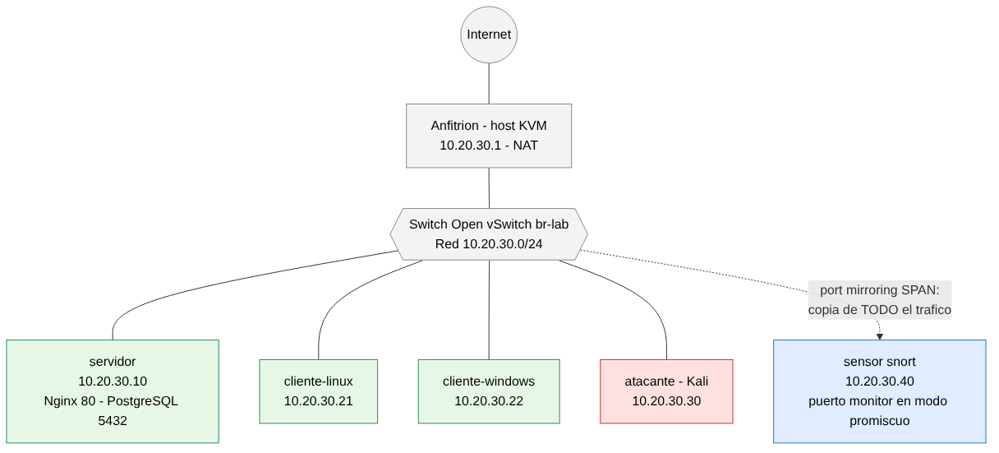

La línea discontinua representa el puerto espejo: el switch copia el tráfico de todos sus puertos hacia `lab-snort-mon`. El resto de líneas son conexiones normales.

| Máquina         | Sistema                            | vCPU | RAM                             | Disco           | Función                                                                       |
| --------------- | ---------------------------------- | ---- | ------------------------------- | --------------- | ----------------------------------------------------------------------------- |
| servidor        | Debian 13 sin entorno gráfico      | 1    | 1,5 GB                          | 20 GB           | Ofrece una web con Nginx (80/tcp) y una base de datos PostgreSQL (5432/tcp)   |
| cliente-linux   | Debian 13 sin entorno gráfico      | 1    | 1 GB                            | 15 GB           | Usuario legítimo: accede a la web con `curl` y a la base de datos con `psql`  |
| cliente-windows | Windows 11 Enterprise (evaluación) | 2    | 4 GB                            | 64 GB           | Usuario legítimo: accede a la web con Edge y a la base de datos con pgAdmin 4 |
| atacante        | Kali Linux (imagen QEMU)           | 2    | 2 GB                            | La de la imagen | Lanza escaneos y ataques contra el servidor                                   |
| snort           | Debian 13 sin entorno gráfico      | 2    | 3 GB (2 GB tras compilar Snort) | 25 GB           | Sensor SDI: analiza el tráfico, registra alertas y envía correos              |

Los dos clientes generan el tráfico normal de la red: consultas web y conexiones a la base de datos desde dos sistemas operativos distintos. El atacante genera el tráfico malicioso contra los mismos servicios, de modo que Snort debe distinguir uno de otro.

HTTP y PostgreSQL se dejan **sin cifrar** a propósito, para que Snort pueda inspeccionar su contenido (las URL y las consultas SQL). En un entorno real se usarían HTTPS y TLS en PostgreSQL, y un NIDS solo vería el contenido si se descifra antes de analizarlo; es una limitación que conviene conocer.

Entre todas las máquinas suman unos 12 GB de RAM. Si el anfitrión tiene menos de 16 GB, se puede prescindir de la máquina Kali y lanzar los ataques desde el propio anfitrión.

## 4. Diseño de red

Todas las máquinas se conectan a un único switch virtual Open vSwitch, `br-lab`, en la subred **10.20.30.0/24**. El anfitrión hace de puerta de enlace con NAT, y un puerto espejo envía al sensor una copia de todo el tráfico del switch.

### 4.1 Elección de la subred

El anfitrión ya tiene otras redes virtuales de prácticas anteriores. Antes de elegir el rango se comprobó cuáles estaban ocupados:

```bash
ip -br addr | grep "10\.10\.10\."
```

La red `lab-log4shell` ya usaba `10.10.10.0/24`. Dos redes con el mismo rango en el mismo anfitrión provocan conflictos de enrutamiento, así que se elige **10.20.30.0/24**, tras comprobar que no se solapa con ninguna red existente.

### 4.2 Direccionamiento

| Equipo          | Interfaz | Puerto del switch | Dirección IP | Función                                           |
| --------------- | -------- | ----------------- | ------------ | ------------------------------------------------- |
| Anfitrión       | `br-lab` | (interno)         | 10.20.30.1   | Puerta de enlace y NAT a internet                 |
| servidor        | `enp1s0` | `lab-servidor`    | 10.20.30.10  | Nginx (80/tcp) y PostgreSQL (5432/tcp)            |
| cliente-linux   | `enp1s0` | `lab-cli-linux`   | 10.20.30.21  | Cliente legítimo Linux                            |
| cliente-windows | Ethernet | `lab-cli-win`     | 10.20.30.22  | Cliente legítimo Windows                          |
| atacante        | `eth0`   | `lab-atacante`    | 10.20.30.30  | Origen de los ataques                             |
| snort           | `enp1s0` | `lab-snort-mgmt`  | 10.20.30.40  | Gestión del sensor (SSH, actualizaciones, correo) |
| snort           | `enp2s0` | `lab-snort-mon`   | Sin IP       | Escucha del tráfico espejado                      |

Los nombres de interfaz dentro de cada máquina pueden variar y se comprueban con `ip a`. Los nombres de los puertos del switch se fijan en la definición de cada máquina, porque el *port mirroring* los referencia por nombre.

### 4.3 Interfaces del sensor

El sensor tiene dos tarjetas de red con funciones separadas, como en una instalación real:

- **Interfaz de gestión (`enp1s0`)**: tiene IP y se usa para administrar el sensor, instalar paquetes y enviar los correos de alerta.
- **Interfaz de monitorización (`enp2s0`)**: no tiene IP y funciona en modo promiscuo. Solo recibe la copia del tráfico. Al no tener dirección, ningún equipo de la red puede comunicarse con ella y el sensor pasa desapercibido.

En esta interfaz se desactivan GRO y LRO, dos optimizaciones de la tarjeta que agrupan paquetes. Así Snort analiza los paquetes tal como circularon por la red.

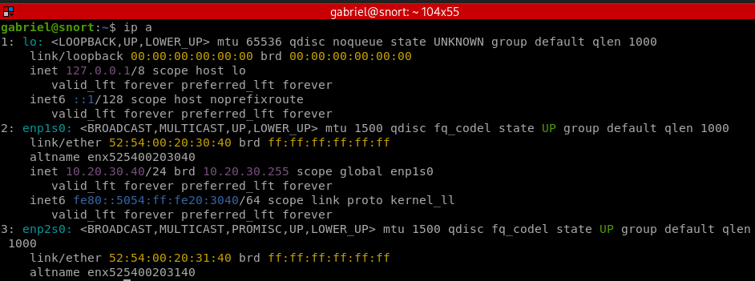

*Interfaces del sensor: `enp1s0` con la IP 10.20.30.40 y `enp2s0` en estado `PROMISC` y sin dirección IPv4.*

### 4.4 Creación del switch

```bash
sudo ovs-vsctl add-br br-lab
```

El switch se registra en libvirt como una red para poder conectar las máquinas a él. Fichero `lab-ovs.xml`:

```xml
<network>
  <name>lab-ovs</name>
  <forward mode="bridge"/>
  <bridge name="br-lab"/>
  <virtualport type="openvswitch"/>
</network>
```

```bash
sudo virsh net-define lab-ovs.xml
sudo virsh net-start lab-ovs
sudo virsh net-autostart lab-ovs
```

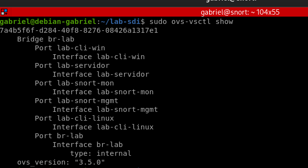

*`ovs-vsctl show`: el switch `br-lab` con un puerto por interfaz de cada máquina (`lab-*`).*

### 4.5 Port mirroring

El switch copia el tráfico de entrada y salida de todos sus puertos hacia `lab-snort-mon`:

```bash
sudo ovs-vsctl -- --id=@mon get Port lab-snort-mon \
  -- --id=@m create Mirror name=span-sdi select-all=true output-port=@mon \
  -- set Bridge br-lab mirrors=@m
```

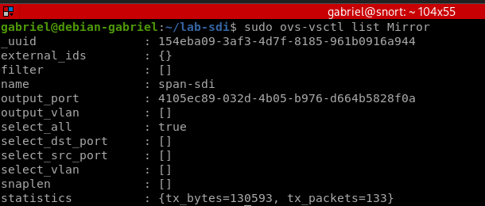

*`ovs-vsctl list Mirror`: el mirror `span-sdi` con `select_all: true` y su puerto de salida. El contador `tx_packets` muestra los paquetes ya copiados hacia el sensor.*

Es el equivalente a una sesión SPAN (`monitor session`) en un switch físico. La configuración del NAT, el arranque de las máquinas y el mirror se automatizan con el script `lab-up.sh` (anexo), que se ejecuta cada vez que se pone en marcha el laboratorio, porque esa configuración no se conserva al reiniciar el anfitrión.

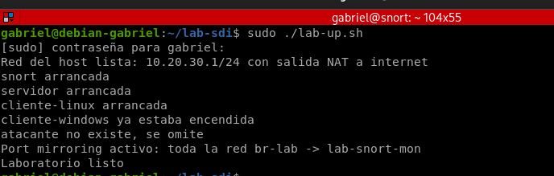

*Ejecución de `lab-up.sh`: red del host con NAT, arranque de las máquinas y activación del port mirroring.*

### 4.6 Creación de las máquinas Debian con cloud-init

Las máquinas `snort`, `servidor` y `cliente-linux` se crean a partir de la imagen cloud oficial de Debian 13 (`debian-13-genericcloud-amd64.qcow2`), ya instalada, en lugar de pasar por el instalador. **cloud-init** aplica la configuración de cada máquina en su primer arranque. El script `crear-vms.sh` (anexo) automatiza el proceso:

1. Copia la imagen base a un disco propio por máquina y lo amplía a su tamaño (25, 20 y 15 GB). La imagen original no se modifica.
2. Genera dos ficheros de cloud-init por máquina, en `cloud-init/<máquina>/`.
3. Crea la máquina con `virt-install --import --cloud-init`, conectada al switch con nombres de puerto y direcciones MAC fijas.

| Fichero          | Qué configura                                                                                                                       |
| ---------------- | ----------------------------------------------------------------------------------------------------------------------------------- |
| `network-config` | IP fija, pasarela 10.20.30.1 y DNS. Cada interfaz se identifica por su MAC, de modo que sus nombres (`enp1s0`, `enp2s0`) no cambian |
| `user-data`      | Nombre de máquina, usuario con sudo, contraseña y clave SSH, zona horaria y paquetes (`tcpdump`; `ethtool` en el sensor)            |

En el sensor, `user-data` crea además el servicio `escucha-snort`, que en cada arranque deja la interfaz `enp2s0` sin IPv6, en modo promiscuo y con GRO/LRO desactivados. Al terminar el primer arranque se crea `/etc/cloud/cloud-init.disabled`, para que cloud-init no vuelva a modificar la red; por eso `cloud-init status` responde después `disabled`.

### 4.7 Creación de la máquina cliente-windows

La máquina `cliente-windows` se instala con Windows 11 Pro (25H2) en español, a partir de la ISO oficial. Windows 11 exige firmware UEFI con Secure Boot y un chip TPM 2.0, por lo que la máquina se crea con ambos emulados.

| Característica                   | Valor                                                              |
| -------------------------------- | ------------------------------------------------------------------ |
| Sistema                          | Windows 11 Pro 25H2, en español                                    |
| vCPU / RAM                       | 2 vCPU (`host-passthrough`) / 4 GB                                 |
| Disco                            | 64 GB, qcow2, bus SATA                                             |
| Firmware                         | UEFI (OVMF) con Secure Boot                                        |
| TPM                              | TPM 2.0 emulado con `swtpm` (modelo CRB)                           |
| Red                              | Tarjeta `e1000e` en el puerto `lab-cli-win`, MAC 52:54:00:20:30:22 |
| Dirección IP                     | 10.20.30.22/24, pasarela 10.20.30.1, DNS 1.1.1.1 (estática)        |
| Usuario                          | Cuenta local `gabriel`, administrador                              |
| Nombre del equipo / zona horaria | `cliente-windows` / Romance Standard Time (Madrid)                 |

El disco SATA y la tarjeta `e1000e` se eligen porque Windows los reconoce sin instalar controladores adicionales, a diferencia de los dispositivos `virtio`.

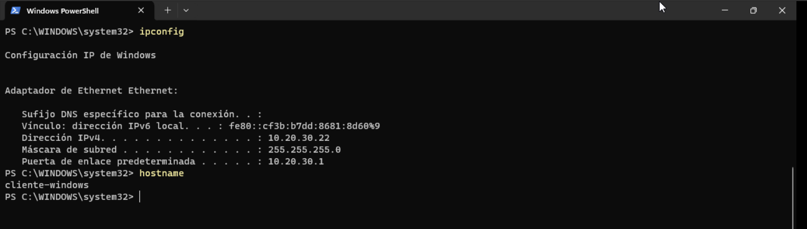

*`ipconfig` y `hostname` en `cliente-windows`: IP 10.20.30.22/24 y puerta de enlace 10.20.30.1.*

### 4.8 Creación de la máquina atacante

La máquina `atacante` se crea a partir de la imagen QEMU oficial de Kali Linux, que ya viene instalada y trae las herramientas de auditoría que se usarán en las pruebas.

| Característica      | Valor                                                                           |
| ------------------- | ------------------------------------------------------------------------------- |
| Sistema             | Kali Linux (imagen QEMU oficial, entorno gráfico)                               |
| vCPU / RAM          | 2 vCPU / 2 GB                                                                   |
| Disco               | Imagen qcow2 de Kali, bus `virtio`                                              |
| Red                 | Tarjeta `virtio` en el puerto `lab-atacante`, MAC 52:54:00:20:30:30             |
| Dirección IP        | 10.20.30.30/24, pasarela 10.20.30.1, DNS 1.1.1.1 (estática, con NetworkManager) |
| Usuario             | `kali`, con la contraseña por defecto cambiada                                  |
| Herramientas usadas | `nmap` (escaneo), `hydra` (fuerza bruta), `nikto` (escaneo web)                 |

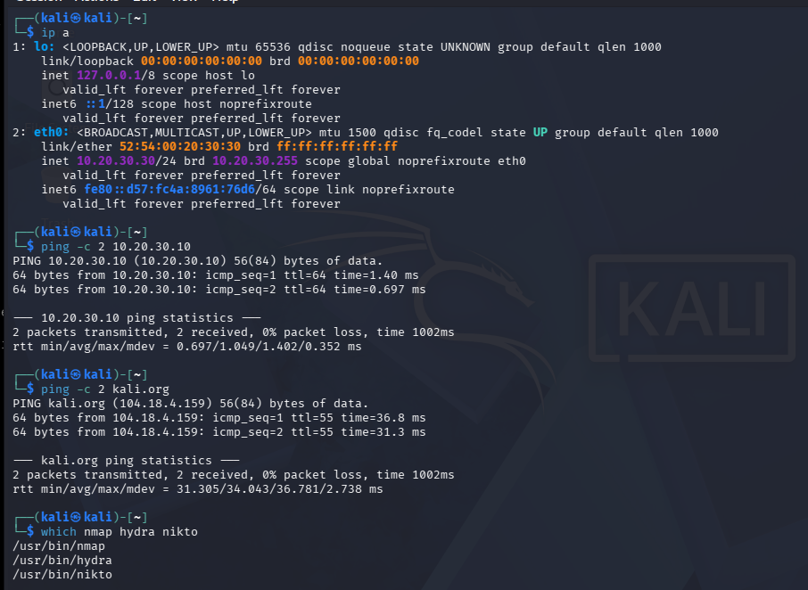

*`ip a`, conectividad con el servidor y con internet, y comprobación de que `nmap`, `hydra` y `nikto` están instalados.*

### 4.9 Servicios del servidor: Nginx y PostgreSQL

El servidor ofrece una web con Nginx (80/tcp) y una base de datos PostgreSQL (5432/tcp). Ambos servicios se dejan **sin cifrar** para que Snort pueda inspeccionar las URL y las consultas SQL.

```bash
sudo apt install nginx postgresql
```

**Nginx** sirve dos páginas: la principal (`/`) y una zona de administración (`/admin/`), que se usará en las reglas propias para detectar accesos no autorizados.

**PostgreSQL** (versión 17) se configura en `/etc/postgresql/17/main/`:

| Fichero           | Cambio                                            | Motivo                                                                                      |
| ----------------- | ------------------------------------------------- | ------------------------------------------------------------------------------------------- |
| `postgresql.conf` | `listen_addresses = 'localhost,10.20.30.10'`      | Escuchar también en la red del laboratorio                                                  |
| `postgresql.conf` | `ssl = off`                                       | Debian activa TLS por defecto; sin cifrado, Snort puede leer las consultas                  |
| `pg_hba.conf`     | `host tienda labuser 10.20.30.0/24 scram-sha-256` | Solo `labuser`, solo a la base `tienda` y solo desde la red del laboratorio, con contraseña |

Se crea el usuario `labuser`, la base de datos `tienda` y una tabla `clientes` con tres registros de ejemplo, para que los clientes generen consultas reales.

```sql
CREATE TABLE clientes (id SERIAL PRIMARY KEY, nombre VARCHAR(50), email VARCHAR(80));
INSERT INTO clientes (nombre, email) VALUES ('Ana', 'ana@lab.local'), ('Luis', 'luis@lab.local'), ('Marta', 'marta@lab.local');
```

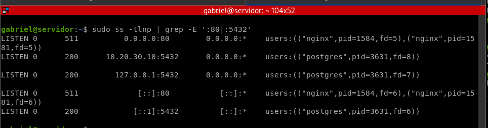

*`ss -tlnp` en el servidor: Nginx en el puerto 80 y PostgreSQL en 10.20.30.10:5432.*

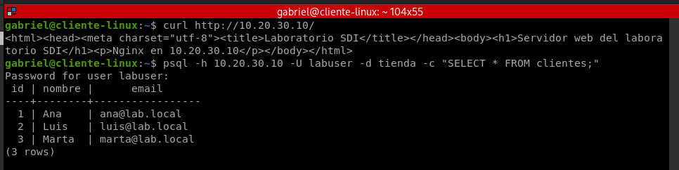

*Desde `cliente-linux`: `curl` obtiene la web y `psql` consulta la tabla `clientes`.*

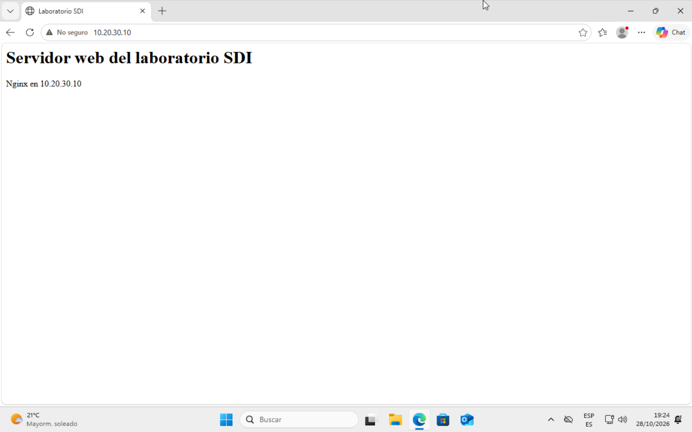

*Desde `cliente-windows`: Edge muestra la web del servidor. El aviso “No seguro” confirma que la conexión es HTTP sin cifrar.*

### 4.10 Verificación del port mirroring

El sensor captura el tráfico entre `cliente-linux` y `servidor`, dos equipos con los que no tiene relación, sin perder ningún paquete. Con `tcpdump` escuchando en la interfaz de monitorización del sensor, se lanza `ping -c 4 10.20.30.10` desde `cliente-linux`:

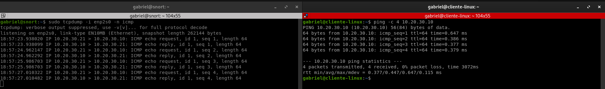

*Izquierda: `tcpdump` en la interfaz de escucha del sensor (`snort`). Derecha: `ping -c 4 10.20.30.10` desde `cliente-linux`. El sensor captura las 4 peticiones y las 4 respuestas entre las otras dos máquinas.*

Aparecen las 4 peticiones y las 4 respuestas, aunque el sensor no es origen ni destino de ese tráfico. Esto confirma que el switch copia el tráfico de los demás puertos a `lab-snort-mon` y que Snort podrá analizar toda la comunicación de la red.

Además de ver los paquetes, el sensor debe poder leer su **contenido**. Para comprobarlo se filtra la captura del puerto 5432 buscando la consulta y los datos de la tabla, mientras `cliente-linux` lanza un `SELECT` contra PostgreSQL:

```bash
sudo tcpdump -i enp2s0 -l -n -A port 5432 | grep --line-buffered -E "SELECT|Ana|Luis|Marta"
```

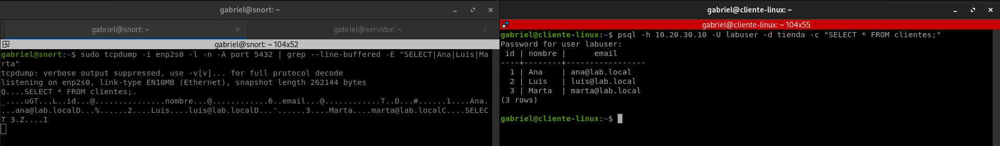

*El sensor lee la consulta `SELECT * FROM clientes;` y la respuesta completa (nombres y correos) en texto plano. Con TLS activado en PostgreSQL esta información aparecería cifrada y Snort no podría analizarla.*

## 5. Estudio de la ubicación del software

El sensor se ubica **dentro de la red interna, conectado a un puerto espejo (SPAN)** del switch. Así analiza todo el tráfico entre equipos y hacia internet sin intervenir en él. Para justificar esta decisión hay que responder a dos preguntas: en qué punto de la red se coloca el sensor y cómo se conecta a ella.

### 5.1 Dónde colocar el sensor

| Ubicación                               | Qué ve                                                                      | Ventaja                                          | Inconveniente                                                       |
| --------------------------------------- | --------------------------------------------------------------------------- | ------------------------------------------------ | ------------------------------------------------------------------- |
| Delante del firewall (lado de internet) | Todo el tráfico que llega desde fuera, también el que el firewall bloqueará | Muestra todos los intentos de ataque             | Genera muchísimas alertas sin importancia; no ve el tráfico interno |
| Detrás del firewall (red interna)       | El tráfico que ha superado el firewall y el tráfico entre equipos internos  | Alertas relevantes; detecta ataques desde dentro | No ve lo que el firewall ya bloqueó                                 |
| En la DMZ                               | El tráfico hacia los servidores publicados                                  | Protege los servicios más expuestos              | No ve la red interna                                                |
| Varios sensores                         | Cada segmento por separado                                                  | Máxima visibilidad                               | Más coste y más alertas que gestionar                               |

En el laboratorio no hay firewall ni DMZ: hay una única red interna. El sensor se coloca en ella, que equivale a la opción **detrás del firewall**, la más habitual en una red corporativa. Desde ahí detecta los ataques entre equipos de la propia red, como los que lanza la máquina atacante contra el servidor.

### 5.2 Cómo conectar el sensor

| Método               | Funcionamiento                                                   | Ventaja                                            | Inconveniente                                                     |
| -------------------- | ---------------------------------------------------------------- | -------------------------------------------------- | ----------------------------------------------------------------- |
| Puerto espejo (SPAN) | El switch copia el tráfico de uno o varios puertos a otro puerto | No requiere hardware adicional; no afecta a la red | Con mucha carga el switch puede descartar copias                  |
| TAP de red           | Un dispositivo físico copia el tráfico de un cable               | Copia exacta, sin pérdidas                         | Hay que comprar el dispositivo y cortar el enlace para instalarlo |
| En línea (*inline*)  | El tráfico atraviesa el sensor                                   | Permite bloquear ataques (modo IPS)                | Si el sensor falla o se satura, la red se corta o se ralentiza    |

Se elige **SPAN** por tres motivos:

1. Es pasivo: si Snort falla o se reinicia, la red sigue funcionando con normalidad.
2. Un solo sensor ve el tráfico de todos los equipos conectados al switch.
3. No requiere hardware adicional: Open vSwitch lo implementa igual que un switch gestionable físico.

La contrapartida es que el sensor recibe una **copia** del tráfico. Las acciones que bloquean paquetes (`drop`, `block`, `reject`) no tienen efecto real, porque el paquete original ya ha llegado a su destino. Por eso en este diseño Snort funciona como **IDS**, no como IPS. Las acciones de bloqueo se demuestran por separado en el apartado de acciones.

## 6. Instalación de Snort 3

Snort 3 no está en los repositorios de Debian 13, así que se compila desde el código fuente en el sensor, junto con **libdaq**, la librería de adquisición de datos con la que Snort captura los paquetes. Se instalan las últimas versiones publicadas en GitHub: **libdaq 3.0.28.0** y **Snort 3.12.4.0**.

### 6.1 Dependencias

```bash
sudo apt install -y build-essential cmake pkg-config git autoconf automake libtool \
  flex bison libpcap-dev libpcre2-dev libdumbnet-dev libhwloc-dev \
  libluajit-5.1-dev luajit libssl-dev zlib1g-dev liblzma-dev libunwind-dev \
  uuid-dev libmnl-dev libnetfilter-queue-dev curl libhyperscan-dev
```

| Paquete                                                       | Función                                                      |
| ------------------------------------------------------------- | ------------------------------------------------------------ |
| `build-essential`, `cmake`, `autoconf`, `automake`, `libtool` | Compilador y herramientas de construcción                    |
| `libpcap-dev`                                                 | Captura de paquetes                                          |
| `libpcre2-dev`                                                | Expresiones regulares (opción `pcre` de las reglas)          |
| `libdumbnet-dev`                                              | Construcción de paquetes de red (respuestas `reject`)        |
| `libluajit-5.1-dev`, `luajit`                                 | Intérprete Lua de la configuración (`snort.lua`)             |
| `libhwloc-dev`                                                | Detección de CPU para el trabajo multihilo                   |
| `libssl-dev`, `zlib1g-dev`, `liblzma-dev`                     | Cifrado y descompresión del tráfico inspeccionado            |
| `libmnl-dev`, `libnetfilter-queue-dev`                        | Módulo NFQ de libdaq (modo IPS en línea)                     |
| `libhyperscan-dev`                                            | Motor de búsqueda de patrones de alto rendimiento (opcional) |

### 6.2 Compilación de libdaq

```bash
mkdir -p ~/src && cd ~/src
DAQ_TAG=$(curl -s https://api.github.com/repos/snort3/libdaq/releases/latest | grep -m1 '"tag_name"' | cut -d'"' -f4)
git clone --depth 1 --branch "$DAQ_TAG" https://github.com/snort3/libdaq.git
cd libdaq
./bootstrap
./configure
make -j"$(nproc)"
sudo make install
sudo ldconfig
```

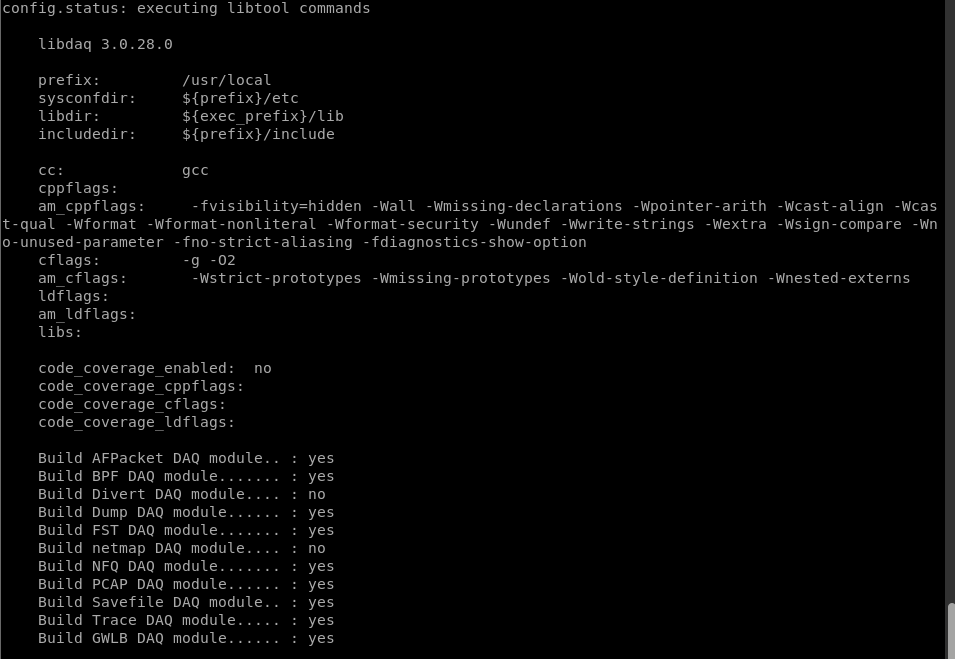

*Resumen de `./configure`: se compilan los módulos que necesita el laboratorio. Divert (solo FreeBSD) y netmap (requiere un módulo del kernel) no se compilan.*

| Módulo DAQ | Uso en el laboratorio                               |
| ---------- | --------------------------------------------------- |
| AFPacket   | Captura del tráfico espejado en `enp2s0` (modo IDS) |
| PCAP       | Análisis de ficheros `.pcap`                        |
| NFQ        | Modo IPS en línea con nftables                      |
| Dump       | Modo `inline-test`: simula las acciones de bloqueo  |

### 6.3 Compilación de Snort 3

```bash
cd ~/src
SNORT_TAG=$(curl -s https://api.github.com/repos/snort3/snort3/releases/latest | grep -m1 '"tag_name"' | cut -d'"' -f4)
git clone --depth 1 --branch "$SNORT_TAG" https://github.com/snort3/snort3.git
cd snort3
./configure_cmake.sh --prefix=/usr/local
cd build
make -j"$(nproc)"
sudo make install
sudo ldconfig
```

Para compilar, el sensor dispone de 3 GB de RAM. Tras la instalación se reduce a 2 GB.

### 6.4 Verificación

```bash
snort -V
snort --daq-list
```

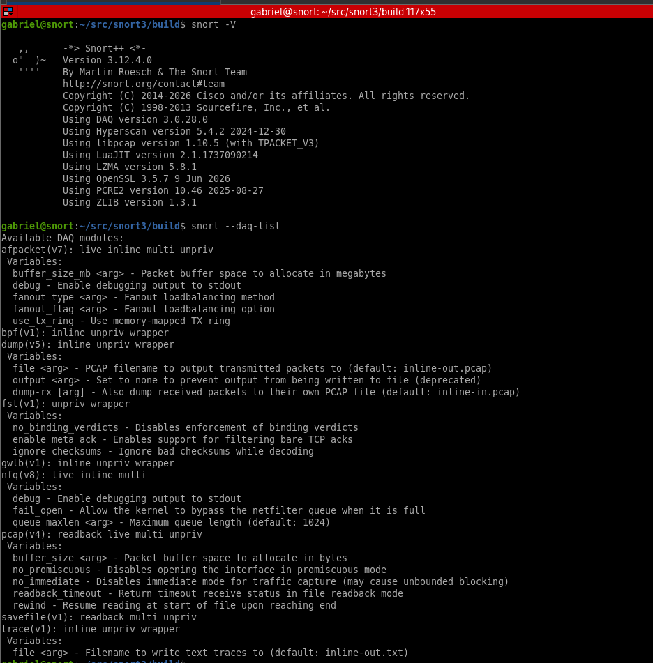

*`snort -V`: Snort 3.12.4.0 con DAQ 3.0.28.0, Hyperscan 5.4.2 y libpcap con TPACKET\_V3. `snort --daq-list`: módulos de captura disponibles; `afpacket` y `nfq` admiten modo `inline`.*

### 6.5 Usuario y directorios

Snort no se ejecuta como root: se crea un usuario de sistema sin shell ni directorio personal. Si se explotara un fallo de Snort, el atacante no tendría control total del sensor.

```bash
sudo useradd -r -M -s /usr/sbin/nologin -c "Snort IDS" snort
sudo mkdir -p /usr/local/etc/rules /var/log/snort
sudo chown -R snort:snort /var/log/snort
sudo chmod 750 /var/log/snort
```

| Directorio              | Propietario y permisos        | Contenido                                              |
| ----------------------- | ----------------------------- | ------------------------------------------------------ |
| `/usr/local/etc/snort/` | root, solo lectura para Snort | Configuración (`snort.lua`)                            |
| `/usr/local/etc/rules/` | root, solo lectura para Snort | Reglas. Snort puede leerlas pero no modificarlas       |
| `/var/log/snort/`       | `snort:snort`, `750`          | Alertas. Solo Snort escribe; solo su grupo y root leen |

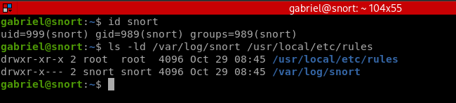

### 6.6 Red protegida: HOME\_NET y EXTERNAL\_NET

Se guarda una copia de la configuración original (`snort.lua.orig`) y se define la red protegida:

```bash
sudo cp /usr/local/etc/snort/snort.lua /usr/local/etc/snort/snort.lua.orig
sudo sed -i "s|^HOME_NET = 'any'|HOME_NET = '10.20.30.0/24'|" /usr/local/etc/snort/snort.lua
```

`EXTERNAL_NET` se deja en `any` a propósito. Muchas reglas tienen la forma `$EXTERNAL_NET -> $HOME_NET`. Si `EXTERNAL_NET` fuera `!$HOME_NET` (todo lo que no es la red interna), los ataques lanzados desde la máquina atacante (10.20.30.30, dentro de la red) no activarían esas reglas. Con `any`, Snort también detecta ataques originados dentro de la red.

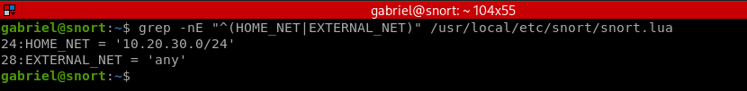

### 6.7 Captura, análisis y salidas de alertas

La configuración del laboratorio se añade como un bloque al final de `snort.lua`. En Lua, un módulo definido al final sustituye al definido antes, por lo que el resto del fichero original no se modifica.

```lua
daq =
{
    inputs = { 'enp2s0' },
    snaplen = 65535,
    modules = { { name = 'afpacket', mode = 'passive' } }
}

network = { checksum_eval = 'none' }

ips =
{
    mode = 'tap',
    enable_builtin_rules = true,
    variables = default_variables,
    rules = [[
        include /usr/local/etc/rules/local.rules
    ]]
}

alert_fast = { file = true, packet = false, limit = 10 }

alert_json =
{
    file = true,
    limit = 50,
    fields = 'timestamp pkt_num proto src_addr src_port dst_addr dst_port action gid sid rev msg class priority'
}

search_engine = { search_method = 'hyperscan' }
```

| Módulo          | Configuración                                            | Motivo                                                                                                                                                                                                                                                 |
| --------------- | -------------------------------------------------------- | ------------------------------------------------------------------------------------------------------------------------------------------------------------------------------------------------------------------------------------------------------ |
| `daq`           | Interfaz `enp2s0`, módulo `afpacket` en modo `passive`   | Lee el tráfico del puerto espejo sin reenviarlo ni bloquearlo                                                                                                                                                                                          |
| `daq`           | `snaplen = 65535`                                        | Las máquinas virtuales agrupan segmentos en paquetes de hasta 64 KB (TSO/GSO) que llegan sin dividir al puerto espejo. Con el valor por defecto (1518 bytes) Snort los recortaba y generaba la alerta `116:6` *IPv4 datagram length > captured length* |
| `network`       | `checksum_eval = 'none'`                                 | Las máquinas virtuales delegan el cálculo del checksum en el hipervisor, y las copias llegan con valores incorrectos. Sin esta opción Snort descartaría casi todo el tráfico TCP sin analizarlo                                                        |
| `ips`           | `mode = 'tap'`                                           | Modo IDS pasivo, coherente con la ubicación en SPAN                                                                                                                                                                                                    |
| `ips`           | `enable_builtin_rules = true`                            | Activa las reglas internas de los inspectores (anomalías de protocolo, escaneos, ARP...)                                                                                                                                                               |
| `ips`           | `rules = [[ include ... ]]`                              | Carga el fichero de reglas propias `local.rules`                                                                                                                                                                                                       |
| `alert_fast`    | Fichero de texto, una línea por alerta, rotación a 10 MB | Lectura rápida por el administrador                                                                                                                                                                                                                    |
| `alert_json`    | Fichero JSON con los campos elegidos, rotación a 50 MB   | Procesado automático (envío de correos)                                                                                                                                                                                                                |
| `search_engine` | `search_method = 'hyperscan'`                            | Usa el motor Hyperscan compilado con Snort en lugar del motor por defecto (`ac_bnfa`)                                                                                                                                                                  |

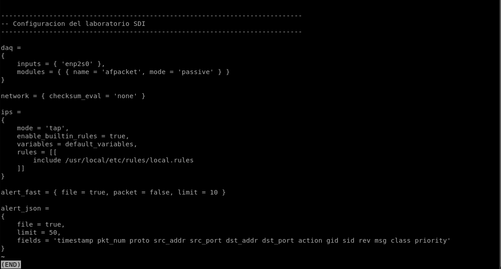

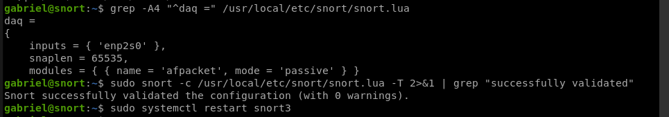

### 6.8 Regla de prueba y validación

Para comprobar el funcionamiento se crea `local.rules` con una regla mínima, que alerta cuando un equipo hace ping (ICMP tipo 8) a una máquina de la red interna:

```text
alert icmp any any -> $HOME_NET any ( msg:"LAB ICMP ping hacia la red interna"; itype:8; sid:1000001; rev:1; )
```

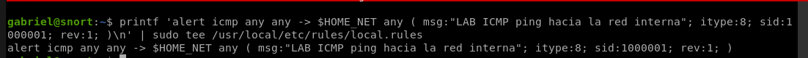

La opción `-T` carga la configuración y las reglas sin empezar a capturar e indica si hay errores:

```bash
sudo snort -c /usr/local/etc/snort/snort.lua -T
```

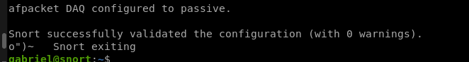

| Contador             | Valor | Origen                                                                                                                |
| -------------------- | ----- | --------------------------------------------------------------------------------------------------------------------- |
| `text rules`         | 220   | 1 regla propia y 219 reglas de identificación de ficheros (`file_magic.rules`) que carga la configuración por defecto |
| `builtin rules`      | 663   | Reglas internas de los inspectores                                                                                    |
| `total rules loaded` | 883   | Suma de las anteriores                                                                                                |

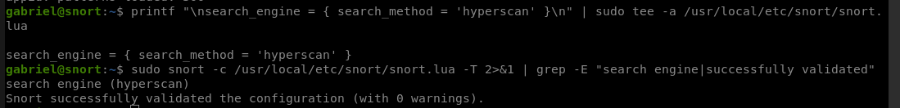

### 6.9 Primera prueba en primer plano

Se ejecuta Snort a mano como usuario `snort` y se lanza `ping -c 3 10.20.30.10` desde `cliente-linux`:

```bash
sudo snort -c /usr/local/etc/snort/snort.lua -l /var/log/snort -u snort -g snort
```

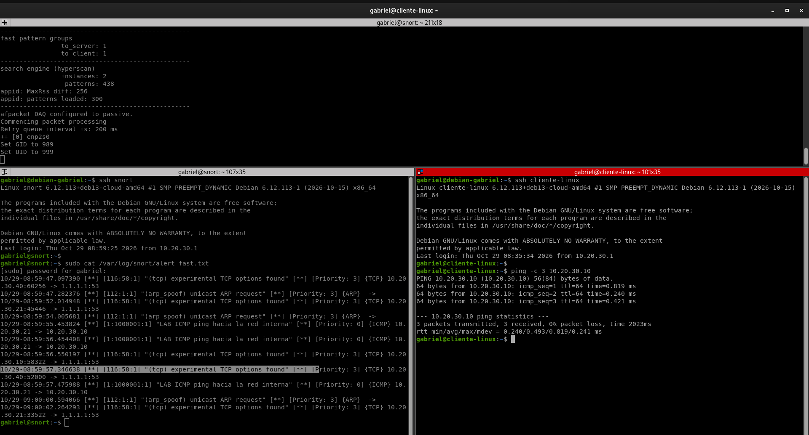

*Arriba: Snort tras `Commencing packet processing`. Abajo: las alertas en `alert_fast.txt` y el ping desde `cliente-linux`. La regla `1:1000001` salta 3 veces, una por cada ping.*

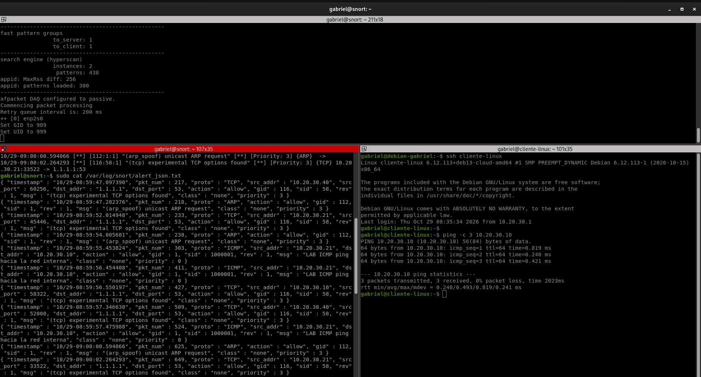

*Las mismas alertas en `alert_json.txt`. Todas tienen `"action" : "allow"`: en modo `tap` Snort solo avisa.*

Además de la regla propia saltan dos reglas internas: `112:1` *(arp\_spoof) unicast ARP request*, porque Linux comprueba sus vecinos con peticiones ARP dirigidas, y `116:58` *(tcp) experimental TCP options found*, en las consultas DNS por TCP de las máquinas. Son ejemplos de reglas por defecto y de falsos positivos que se tratan en los apartados siguientes.

Al detener Snort se muestran las estadísticas de la sesión:

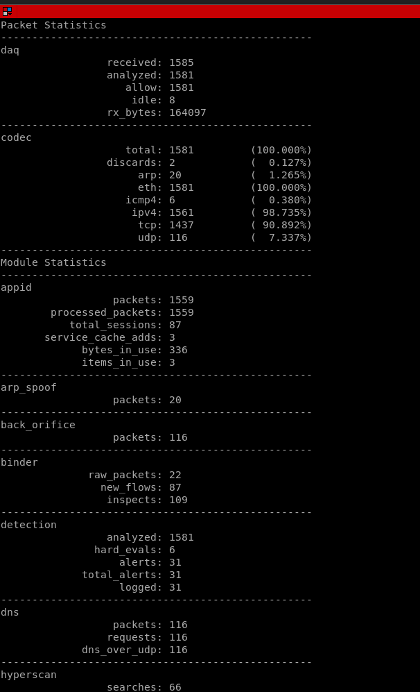

| Contador                     | Valor       | Significado                                          |
| ---------------------------- | ----------- | ---------------------------------------------------- |
| `daq: received` / `analyzed` | 1585 / 1581 | Paquetes recibidos por el puerto espejo y analizados |
| `daq: allow`                 | 1581        | Todos se dejan pasar (modo IDS)                      |
| `codec: icmp4`               | 6           | Los 3 echo request y sus 3 echo reply                |
| `detection: alerts`          | 31          | Alertas generadas y registradas                      |

### 6.10 Servicio systemd

Para que Snort arranque con el sensor se crea el servicio `/etc/systemd/system/snort3.service`:

```ini
[Unit]
Description=Snort 3 - Sistema de deteccion de intrusos del laboratorio
After=network-online.target escucha-snort.service
Wants=network-online.target
Requires=escucha-snort.service

[Service]
Type=simple
ExecStart=/usr/local/bin/snort -c /usr/local/etc/snort/snort.lua -l /var/log/snort -u snort -g snort -q
Restart=on-failure
RestartSec=5

[Install]
WantedBy=multi-user.target
```

- `Requires` y `After` con `escucha-snort.service`: Snort no arranca hasta que la interfaz de escucha está en modo promiscuo y sin IP.
- `-q`: modo silencioso; las alertas solo se escriben en los ficheros.
- `Restart=on-failure`: si Snort se detiene por un error, systemd lo vuelve a arrancar a los 5 segundos.

```bash
sudo systemctl daemon-reload
sudo systemctl enable --now snort3
```

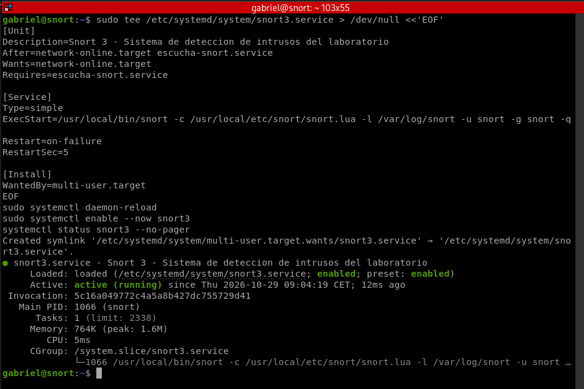

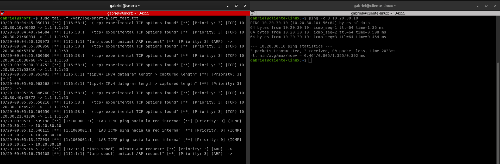

*Con Snort funcionando como servicio, `tail -f` muestra las alertas en tiempo real al lanzar el ping desde `cliente-linux`.*

## 7. Reglas por defecto

Las reglas por defecto son las que Snort aplica sin que el administrador escriba ninguna regla. El sensor utiliza dos familias: las **reglas internas** de los inspectores, incluidas en Snort, y las **reglas de la comunidad** publicadas por Cisco Talos.

### 7.1 Concepto

| Tipo                           | GID                                   | Qué son                                                                                                                                              | Cómo se activan                                  |
| ------------------------------ | ------------------------------------- | ---------------------------------------------------------------------------------------------------------------------------------------------------- | ------------------------------------------------ |
| Reglas internas (*builtin*)    | Distinto de 1 (112, 116, 119, 122...) | Detecciones programadas dentro de los decodificadores e inspectores: anomalías de protocolo, escaneos de puertos, ARP sospechoso, HTTP malformado... | `enable_builtin_rules = true` en el módulo `ips` |
| Reglas de texto (*text rules*) | 1                                     | Ficheros `.rules` con firmas de ataques conocidos                                                                                                    | `include` del fichero en el módulo `ips`         |

Cada alerta se identifica por tres números `[GID:SID:REV]`: el generador que la produce, el identificador de la regla y su revisión. Por ejemplo, `[112:1:1]` es la regla 1 del inspector `arp_spoof`.

Cisco Talos publica las reglas de texto en tres conjuntos:

| Conjunto   | Coste                                   | Contenido                                                                                               |
| ---------- | --------------------------------------- | ------------------------------------------------------------------------------------------------------- |
| Community  | Gratuito, sin registro (licencia GPLv2) | Reglas aportadas por la comunidad y revisadas por Talos. **Es el conjunto utilizado en el laboratorio** |
| Registered | Gratuito, con cuenta en snort.org       | Reglas de Talos con 30 días de retraso respecto a los suscriptores                                      |
| Subscriber | De pago                                 | Reglas de Talos en el momento de su publicación                                                         |

### 7.2 Instalación de las reglas de la comunidad

```bash
cd /tmp
curl -LO https://www.snort.org/downloads/community/snort3-community-rules.tar.gz
sudo tar -xzf snort3-community-rules.tar.gz -C /usr/local/etc/rules/
sudo chown -R root:root /usr/local/etc/rules/snort3-community-rules
```

El paquete contiene **4024 reglas**, todas activas: ninguna línea del fichero está comentada.

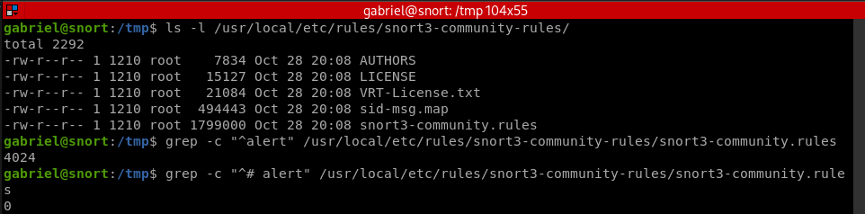

| Fichero                                 | Contenido                            |
| --------------------------------------- | ------------------------------------ |
| `snort3-community.rules`                | Las reglas                           |
| `sid-msg.map`                           | Relación entre cada SID y su mensaje |
| `AUTHORS`, `LICENSE`, `VRT-License.txt` | Autoría y licencias                  |

Al descomprimir con `sudo`, `tar` conserva el propietario original del paquete (el usuario 1210 de la máquina de Talos). Se cambia a `root:root` para que ningún usuario del sensor con ese UID pueda modificar las reglas.

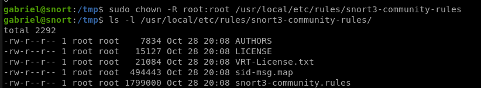

### 7.3 Carga en Snort

Se añade el fichero al bloque `ips` del laboratorio, debajo de las reglas propias:

```bash
sudo sed -i "s|        include /usr/local/etc/rules/local.rules|        include /usr/local/etc/rules/local.rules\n        include /usr/local/etc/rules/snort3-community-rules/snort3-community.rules|" /usr/local/etc/snort/snort.lua
```

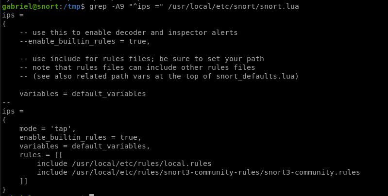

*Arriba, el bloque `ips` original de Snort, con las reglas internas desactivadas y sin ficheros de reglas. Abajo, el bloque del laboratorio, que lo sustituye por estar al final del fichero.*

Tras validar la configuración se reinicia el servicio:

```bash
sudo snort -c /usr/local/etc/snort/snort.lua -T
sudo systemctl restart snort3
```

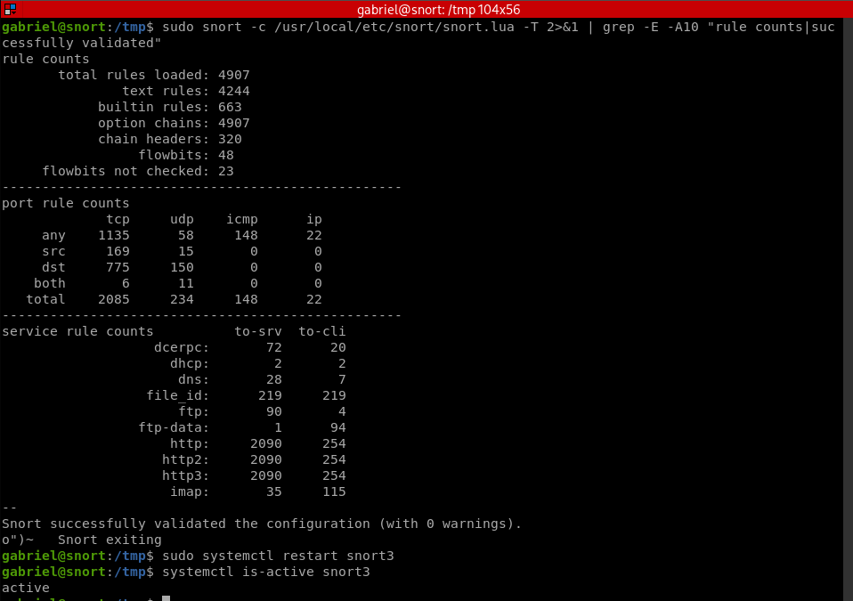

| Contador             | Antes | Después | Comentario                                                                                                            |
| -------------------- | ----- | ------- | --------------------------------------------------------------------------------------------------------------------- |
| `text rules`         | 220   | 4244    | Se añaden las 4024 reglas de la comunidad                                                                             |
| `builtin rules`      | 663   | 663     | Las reglas internas no cambian                                                                                        |
| `total rules loaded` | 883   | 4907    | Suma de las anteriores                                                                                                |
| `flowbits`           | 0     | 48      | Reglas encadenadas: una marca la conexión y otra solo salta si la marca existe, para detectar ataques en varios pasos |

Por servicio, el grupo más numeroso es `http`, con 2090 reglas hacia el servidor: la mayoría de las reglas de la comunidad detectan ataques web.

### 7.4 Ejemplos de funcionamiento

Para cada prueba se anota el número de alertas antes del ataque y después se resumen solo las alertas nuevas, agrupadas por regla:

```bash
ANTES=$(sudo cat /var/log/snort/alert_fast.txt | wc -l)
# ... ataque desde la máquina atacante ...
sudo tail -n +$((ANTES+1)) /var/log/snort/alert_fast.txt | grep -oE '\[[0-9]+:[0-9]+:[0-9]+\] "[^"]+"' | sort | uniq -c | sort -rn | head -20
```

#### Escaneo de puertos (regla interna port\_scan)

Desde la máquina atacante se lanza un escaneo SYN de los 65535 puertos TCP del servidor:

```bash
sudo nmap -sS -p- 10.20.30.10
```

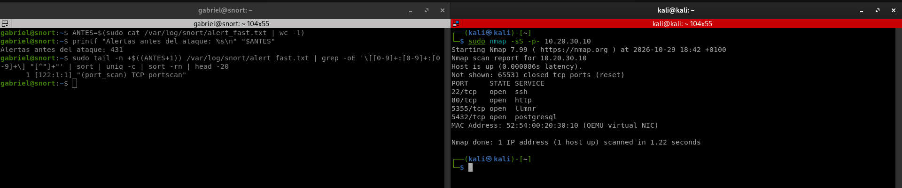

*Derecha: `nmap` encuentra abiertos los puertos 22 (SSH), 80 (HTTP), 5432 (PostgreSQL) y 5355 (LLMNR). Izquierda: el sensor genera una única alerta `[122:1:1] (port_scan) TCP portscan`.*

El inspector `port_scan` (GID 122) no compara firmas: cuenta cuántos puertos distintos toca una misma IP en un intervalo de tiempo y, al superar el umbral, genera **una alerta por escaneo**, no una por puerto. Es una regla interna: se activa sin escribir ninguna regla, gracias a `enable_builtin_rules = true`.

El escaneo también revela un servicio que no se instaló expresamente: **LLMNR (5355/tcp)**, un protocolo de resolución de nombres que activa `systemd-resolved` en Debian. Es un ejemplo de la información que obtiene un atacante con un simple escaneo.

#### Detección de servicios y versiones (reglas internas y de la comunidad)

Un escaneo de servicios es más intrusivo: nmap se conecta a cada servicio abierto, le envía sondas para identificar el programa y su versión (`-sV`) y ejecuta sus scripts de reconocimiento por defecto (`-sC`):

```bash
sudo nmap -sV -sC -p 22,80,5432 10.20.30.10
```

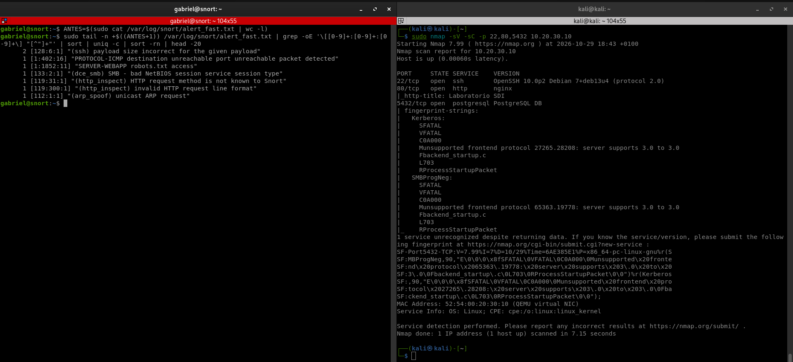

*Derecha: nmap identifica OpenSSH 10.0p2, nginx y PostgreSQL, y obtiene el título de la web. Izquierda: alertas de reglas internas y de la comunidad.*

| Alerta                                                                 | Tipo      | Causa                                                                                                                                                    |
| ---------------------------------------------------------------------- | --------- | -------------------------------------------------------------------------------------------------------------------------------------------------------- |
| `[1:1852:11]` SERVER-WEBAPP robots.txt access                          | Comunidad | El script `http-robots.txt` de nmap pide `/robots.txt`, un fichero que revela rutas ocultas del sitio. Es un indicador típico de reconocimiento web      |
| `[1:402:16]` PROTOCOL-ICMP destination unreachable port unreachable    | Comunidad | El servidor responde con ICMP *port unreachable* a una de las sondas de nmap                                                                             |
| `[119:31:1]` (http\_inspect) HTTP request method is not known to Snort | Interna   | nmap prueba métodos HTTP inexistentes para ver cómo responde el servidor                                                                                 |
| `[119:300:1]` (http\_inspect) invalid HTTP request line format         | Interna   | Peticiones HTTP mal formadas enviadas por las sondas de versión                                                                                          |
| `[128:6:1]` (ssh) payload size incorrect for the given payload         | Interna   | Las sondas de nmap al puerto 22 envían paquetes SSH con un tamaño incoherente                                                                            |
| `[133:2:1]` (dce\_smb) SMB - bad NetBIOS session service session type  | Interna   | nmap envía al puerto 5432 una sonda de SMB (`SMBProgNeg`, visible en la huella de PostgreSQL del escaneo) y Snort la analiza como tráfico SMB malformado |
| `[112:1:1]` (arp\_spoof) unicast ARP request                           | Interna   | Ruido de la red, no relacionado con el ataque                                                                                                            |

Con un único escaneo saltan reglas de varios inspectores distintos (`http_inspect`, `ssh`, `dce_smb`, `arp_spoof`) y reglas de la comunidad de HTTP e ICMP. Snort identifica cada protocolo aunque viaje por un puerto que no es el suyo, como la sonda SMB enviada al puerto de PostgreSQL.

#### Escaneo web con Nikto (reglas de la comunidad e http\_inspect)

Nikto es un escáner de vulnerabilidades web: envía miles de peticiones en busca de ficheros peligrosos, configuraciones inseguras y fallos conocidos. Se limita a 2 minutos:

```bash
nikto -h http://10.20.30.10 -maxtime 120s
```

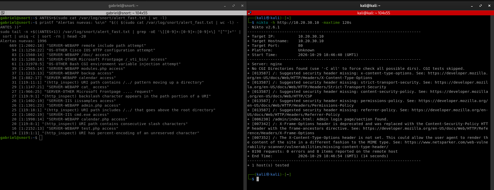

*Derecha: Nikto envía 8198 peticiones en 14 segundos y encuentra, entre otros, la zona `/admin/` y la falta de cabeceras de seguridad. Izquierda: el sensor genera 1996 alertas.*

Las alertas más frecuentes muestran qué busca Nikto:

| Alerta                                                                 | N.º | Qué intenta el atacante                                                                                  |
| ---------------------------------------------------------------------- | --- | -------------------------------------------------------------------------------------------------------- |
| `[1:2002:18]` SERVER-WEBAPP remote include path attempt                | 669 | Inclusión remota de ficheros (RFI): hacer que la aplicación cargue y ejecute un fichero de otro servidor |
| `[1:1250:22]` OS-OTHER Cisco IOS HTTP configuration attempt            | 94  | Acceder a la configuración de routers Cisco por su interfaz web                                          |
| `[1:1560:14]` SERVER-WEBAPP /doc/ access                               | 83  | Directorios de documentación que revelan versiones del software                                          |
| `[1:1288:18]` SERVER-OTHER Microsoft Frontpage /\_vti\_bin/ access     | 63  | Extensiones de Frontpage, antiguas y vulnerables, de servidores IIS                                      |
| `[1:31978:5]` OS-OTHER Bash CGI environment variable injection attempt | 61  | **Shellshock**: ejecutar comandos en el servidor mediante variables de entorno de scripts CGI            |
| `[1:1213:13]` SERVER-WEBAPP backup access                              | 37  | Copias de seguridad olvidadas en el servidor web                                                         |
| `[119:11:1]` (http\_inspect) URI path contains /../                    | 31  | **Directory traversal**: salir del directorio web para leer otros ficheros del sistema                   |
| `[1:1002:19]` SERVER-IIS cmd.exe access                                | 23  | Ejecutar la consola de comandos de Windows a través de IIS                                               |

En este caso saltan sobre todo las **reglas de la comunidad** (GID 1), que reconocen firmas de ataques conocidos en las URL, y el inspector **http\_inspect** (GID 119), que detecta URL anormales aunque no correspondan a un ataque concreto.

Muchas alertas corresponden a ataques contra productos que el servidor no tiene (IIS, Frontpage, routers Cisco): Nikto los prueba todos y Snort avisa de cada intento. **Una alerta indica un intento de ataque, no que el ataque haya tenido éxito.** El administrador debe interpretarlas en su contexto y ajustar las reglas para reducir el ruido, como se verá en el apartado de opciones de las reglas.

#### Resumen de las pruebas

| Prueba                 | Herramienta    | Alertas | Reglas que la detectan                                                                     |
| ---------------------- | -------------- | ------- | ------------------------------------------------------------------------------------------ |
| Escaneo de puertos     | `nmap -sS -p-` | 1       | Interna `port_scan` (122)                                                                  |
| Detección de servicios | `nmap -sV -sC` | 8       | Internas `http_inspect` (119), `ssh` (128), `dce_smb` (133) y de la comunidad (HTTP, ICMP) |
| Escaneo web            | `nikto`        | 1996    | Comunidad (ataques web conocidos) y `http_inspect` (119)                                   |

Cuanto más intrusivo es el ataque, más alertas genera. Las reglas por defecto detectan las tres fases de reconocimiento de un atacante sin escribir ninguna regla propia.

## 8. Reglas propias

Las reglas por defecto detectan ataques genéricos, pero no conocen el escenario: qué equipos son clientes legítimos, qué servicios ofrece el servidor o qué operaciones son peligrosas en su base de datos. Las **reglas propias** se escriben en `/usr/local/etc/rules/local.rules` para cubrir esos casos.

### 8.1 Variables del escenario

En lugar de escribir las direcciones IP dentro de cada regla, se definen variables con nombre al final de `snort.lua`, igual que `HOME_NET`. Si cambia una dirección, solo se modifica en un lugar:

```lua
default_variables.nets.SERVIDOR_LAB = '10.20.30.10'
default_variables.nets.CLIENTES_LAB = '[10.20.30.21,10.20.30.22]'
```

| Variable        | Valor                     | Uso                                                 |
| --------------- | ------------------------- | --------------------------------------------------- |
| `$SERVIDOR_LAB` | 10.20.30.10               | Destino de las reglas sobre Nginx, PostgreSQL y SSH |
| `$CLIENTES_LAB` | 10.20.30.21 y 10.20.30.22 | Clientes legítimos (Linux y Windows)                |

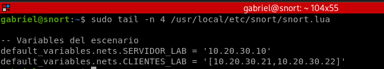

### 8.2 Reglas creadas

| SID     | Qué detecta                                                     | Motivo en el escenario                                          |
| ------- | --------------------------------------------------------------- | --------------------------------------------------------------- |
| 1000001 | Ping hacia la red interna                                       | Regla de prueba del funcionamiento                              |
| 1000010 | Acceso a `/admin` desde un equipo que no es cliente legítimo    | Solo los dos clientes deben acceder al panel de administración  |
| 1000011 | Escáner Nikto, por su *User-Agent*                              | Identifica la herramienta concreta usada en el ataque           |
| 1000012 | Scripts de Nmap contra la web, por su *User-Agent*              | Identifica la herramienta concreta usada en el reconocimiento   |
| 1000020 | Consulta `DROP TABLE` a PostgreSQL                              | Borrar una tabla no forma parte del uso normal de la aplicación |
| 1000021 | Contraseña incorrecta en PostgreSQL                             | Intentos de acceso no autorizado a la base de datos             |
| 1000030 | Más de 5 conexiones SSH nuevas en 60 segundos desde la misma IP | Ataque de fuerza bruta contra SSH                               |

```text
# Reglas propias del laboratorio SDI

# Prueba: ping hacia la red interna
alert icmp any any -> $HOME_NET any ( msg:"LAB ICMP ping hacia la red interna"; itype:8; sid:1000001; rev:1; )

# Web: acceso al panel de administracion desde un equipo no autorizado
alert tcp !$CLIENTES_LAB any -> $SERVIDOR_LAB 80 ( msg:"LAB Acceso a /admin desde equipo no autorizado"; flow:to_server,established; service:http; http_uri; content:"/admin",nocase; classtype:web-application-attack; sid:1000010; rev:1; )

# Web: herramientas de escaneo identificadas por su User-Agent
alert tcp any any -> $SERVIDOR_LAB 80 ( msg:"LAB Escaner web Nikto detectado"; flow:to_server,established; service:http; http_header:field user-agent; content:"Nikto",nocase; classtype:web-application-activity; sid:1000011; rev:1; )
alert tcp any any -> $SERVIDOR_LAB 80 ( msg:"LAB Scripts de Nmap contra la web detectados"; flow:to_server,established; service:http; http_header:field user-agent; content:"Nmap Scripting Engine"; classtype:attempted-recon; sid:1000012; rev:1; )

# PostgreSQL: borrado de tablas
alert tcp any any -> $SERVIDOR_LAB 5432 ( msg:"LAB PostgreSQL consulta DROP TABLE"; flow:to_server,established; content:"DROP",nocase; pcre:"/DROP\s+TABLE/i"; classtype:attempted-admin; sid:1000020; rev:1; )

# PostgreSQL: autenticacion fallida (respuesta del servidor)
alert tcp $SERVIDOR_LAB 5432 -> any any ( msg:"LAB PostgreSQL contrasena incorrecta"; flow:to_client,established; content:"password authentication failed",nocase; classtype:unsuccessful-user; sid:1000021; rev:1; )

# SSH: fuerza bruta (mas de 5 conexiones nuevas en 60 s desde la misma IP)
alert tcp any any -> $SERVIDOR_LAB 22 ( msg:"LAB Posible fuerza bruta SSH"; flow:to_server; flags:S; detection_filter:track by_src, count 5, seconds 60; classtype:attempted-user; sid:1000030; rev:1; )
```

Las reglas propias usan SID a partir de 1.000.000, el rango reservado para reglas locales, y un mensaje que empieza por `LAB` para distinguirlas en los registros. Las opciones que usa cada una se explican en el apartado siguiente.

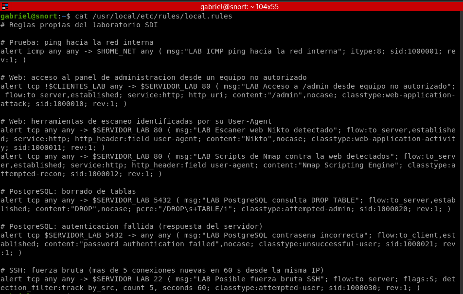

### 8.3 Validación

```bash
sudo snort -c /usr/local/etc/snort/snort.lua -T
sudo systemctl restart snort3
```

El número de reglas de texto pasa de 4244 a 4250, con las 6 reglas nuevas.

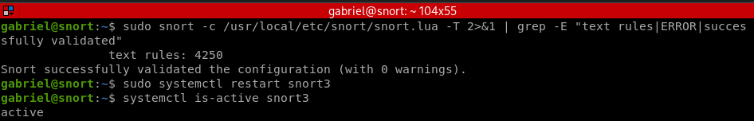

### 8.4 Ejemplos de funcionamiento

#### Reglas web: /admin, Nikto y Nmap

Desde la máquina atacante se accede a `/admin/`, se lanza el script `http-title` de nmap y un escaneo corto de Nikto:

```bash
curl http://10.20.30.10/admin/
nmap -p 80 --script http-title 10.20.30.10
nikto -h http://10.20.30.10 -maxtime 10s
```

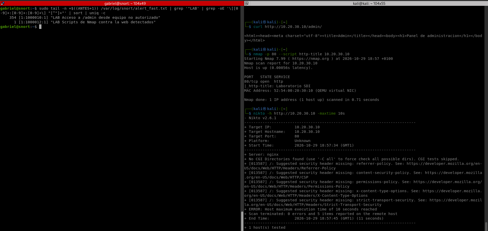

| Regla                   | Alertas | Resultado                                                                                                |
| ----------------------- | ------- | -------------------------------------------------------------------------------------------------------- |
| 1000010 Acceso a /admin | 354     | Salta con el `curl` y con las rutas de Nikto que contienen `/admin` (`/admin.php`, `/administrator/`...) |
| 1000012 Scripts de Nmap | 1       | El script `http-title` se identifica como *Nmap Scripting Engine*                                        |
| 1000011 Nikto           | 0       | No salta (ver más abajo)                                                                                 |

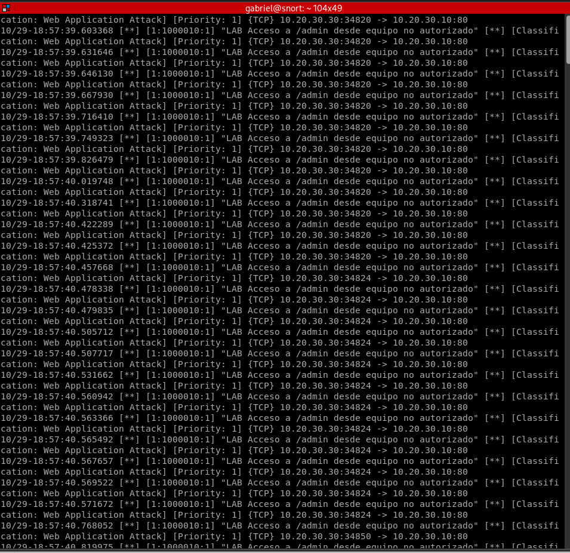

*Todas las alertas de `/admin` tienen como origen la máquina atacante (10.20.30.30).*

**Cliente legítimo.** El mismo acceso a `/admin/` desde `cliente-linux` no genera ninguna alerta: la regla excluye el origen `!$CLIENTES_LAB`.

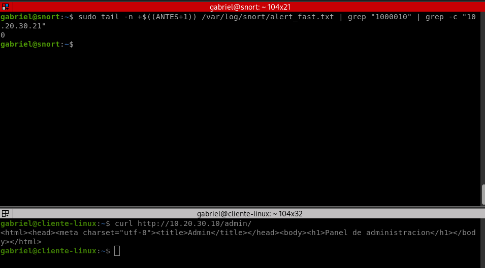

**Evasión de la regla de Nikto.** La regla 1000011 busca la palabra `Nikto` en el *User-Agent*. Al capturar las peticiones se comprueba que Nikto 2.6.1 se presenta como Google Chrome en Windows 10. Forzando el *User-Agent* con `-useragent "Nikto"`, la regla sí salta:

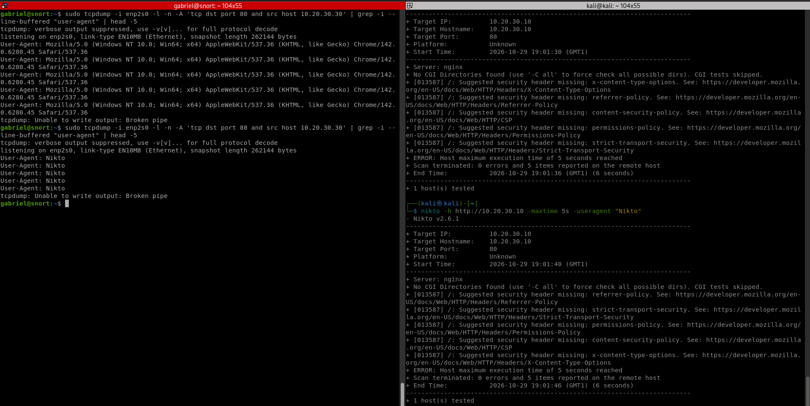

*Arriba: por defecto, Nikto envía el* User-Agent *de un navegador. Abajo: con `-useragent "Nikto"` se identifica como Nikto.*

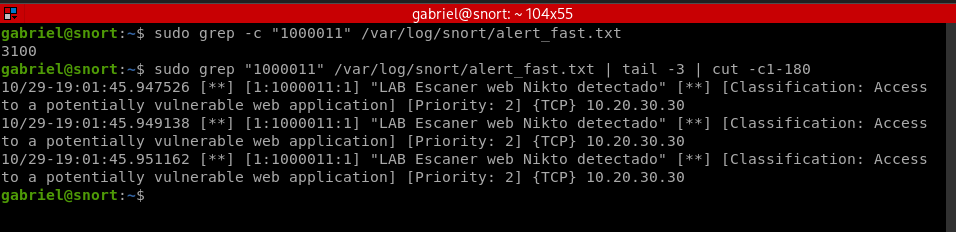

*Con el* User-Agent *forzado, la regla genera 3100 alertas en 5 segundos, una por petición.*

Esta prueba muestra una **limitación de los IDS basados en firmas**: una regla que depende de un dato que controla el atacante, como el nombre con el que se identifica su herramienta, se evade simplemente cambiando ese dato. La regla de `/admin`, en cambio, se basa en lo que el atacante necesita pedir al servidor para conseguir su objetivo, y no puede esquivarla.

#### Reglas de PostgreSQL

Se simula un atacante que intenta acceder a la base de datos sin conocer la contraseña y, después, uno que ya la ha obtenido y borra una tabla. Para no afectar a los datos, se crea y se borra una tabla de prueba:

```bash
PGPASSWORD=incorrecta psql -h 10.20.30.10 -U labuser -d tienda -c "SELECT 1;"
psql -h 10.20.30.10 -U labuser -d tienda -c "CREATE TABLE prueba_ataque (id int);"
psql -h 10.20.30.10 -U labuser -d tienda -c "DROP TABLE prueba_ataque;"
```

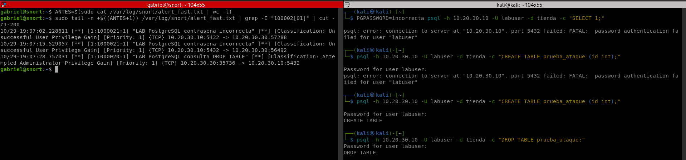

*Derecha: dos contraseñas incorrectas, la creación de la tabla y su borrado. Izquierda: una alerta 1000021 por cada contraseña incorrecta y una alerta 1000020 por el `DROP TABLE`.*

| Regla                         | Alertas                    | Dirección del tráfico                                                                                                         |
| ----------------------------- | -------------------------- | ----------------------------------------------------------------------------------------------------------------------------- |
| 1000021 Contraseña incorrecta | 2, una por intento fallido | Servidor → atacante (10.20.30.10:5432 → 10.20.30.30). La regla analiza la **respuesta** de error del servidor, no la petición |
| 1000020 DROP TABLE            | 1                          | Atacante → servidor (10.20.30.30 → 10.20.30.10:5432). La regla analiza la **consulta** enviada                                |

La creación de la tabla no genera alerta: la regla solo considera peligroso el borrado. Las dos reglas son posibles porque PostgreSQL viaja sin cifrar; con TLS, Snort no podría leer ni la consulta ni el mensaje de error.

#### Regla de fuerza bruta SSH

Desde la máquina atacante se lanza un ataque de fuerza bruta con `hydra`, que prueba el usuario `gabriel` con el diccionario `rockyou.txt` (más de 14 millones de contraseñas), con 4 conexiones simultáneas:

```bash
hydra -l gabriel -P /usr/share/wordlists/rockyou.txt -t 4 ssh://10.20.30.10
```

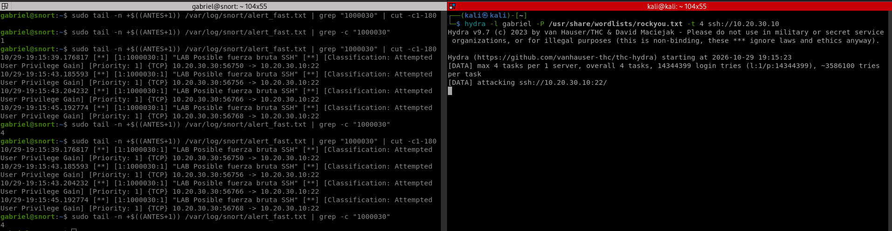

*Derecha: hydra inicia el ataque con 14.344.399 contraseñas. Izquierda: la regla 1000030 genera 4 alertas, todas con origen 10.20.30.30 y destino 10.20.30.10:22.*

La regla usa `detection_filter:track by_src, count 5, seconds 60`, por lo que **no genera una alerta por cada intento**, sino que empieza a avisar a partir de la sexta conexión de la misma IP en 60 segundos. Así distingue un ataque de fuerza bruta de un usuario que simplemente se equivoca de contraseña una o dos veces, y evita inundar el registro con una alerta por intento.

#### Resumen de las reglas propias

| SID     | Prueba                                                          | Resultado                                                  |
| ------- | --------------------------------------------------------------- | ---------------------------------------------------------- |
| 1000010 | Acceso a `/admin` desde el atacante / desde un cliente legítimo | Alerta solo desde el atacante                              |
| 1000011 | Nikto con *User-Agent* por defecto / forzado                    | Solo salta con el *User-Agent* forzado (evasión por firma) |
| 1000012 | Script `http-title` de nmap                                     | Alerta por el *User-Agent* de Nmap                         |
| 1000020 | `DROP TABLE` en PostgreSQL                                      | Alerta; el `CREATE TABLE` no                               |
| 1000021 | Contraseña incorrecta en PostgreSQL                             | Una alerta por intento fallido                             |
| 1000030 | Fuerza bruta SSH con hydra                                      | Alerta a partir de la sexta conexión en 60 s               |

## 9. Opciones de las reglas

Una regla de Snort tiene dos partes: la **cabecera**, que decide a qué paquetes se aplica, y el **cuerpo** entre paréntesis, una lista de opciones que afinan la detección y describen la alerta. Este apartado desmonta las opciones usando las reglas propias ya creadas.

### 9.1 La cabecera

```text
alert   tcp   !$CLIENTES_LAB any   ->   $SERVIDOR_LAB 80
(1)     (2)   (3)          (4)   (5)  (6)          (7)
```

| N.º | Campo          | Significado                                                                     |
| --- | -------------- | ------------------------------------------------------------------------------- |
| 1   | Acción         | Qué hace Snort al coincidir. Aquí `alert`; el resto se ven en el apartado 10    |
| 2   | Protocolo      | `tcp`, `udp`, `icmp` o `ip`                                                     |
| 3   | IP origen      | `!$CLIENTES_LAB` = cualquiera **excepto** los clientes legítimos (el `!` niega) |
| 4   | Puerto origen  | `any` = cualquier puerto                                                        |
| 5   | Dirección      | `->` del origen al destino; `<>` en ambos sentidos                              |
| 6   | IP destino     | La variable `$SERVIDOR_LAB`                                                     |
| 7   | Puerto destino | `80`                                                                            |

### 9.2 Opciones del cuerpo

Las opciones se separan por `;`. Se agrupan en tres tipos.

**Opciones informativas** (describen la alerta, no detectan nada):

| Opción      | Función                                                           | Ejemplo en las reglas                     |
| ----------- | ----------------------------------------------------------------- | ----------------------------------------- |
| `msg`       | Texto de la alerta                                                | `msg:"LAB Posible fuerza bruta SSH"`      |
| `sid`       | Identificador único de la regla (≥ 1.000.000 para reglas propias) | `sid:1000030`                             |
| `rev`       | Revisión de la regla                                              | `rev:1`                                   |
| `classtype` | Categoría del ataque; fija la prioridad por defecto               | `classtype:attempted-admin` (prioridad 1) |
| `reference` | Enlace a un CVE o aviso (no usado aquí)                           | `reference:cve,2014-6271`                 |

**Opciones de flujo y protocolo** (acotan cuándo mirar):

| Opción    | Función                                                       | Ejemplo                                                                                         |
| --------- | ------------------------------------------------------------- | ----------------------------------------------------------------------------------------------- |
| `flow`    | Estado y sentido de la conexión                               | `flow:to_server,established` solo mira paquetes hacia el servidor en conexiones ya establecidas |
| `service` | Identifica el protocolo de aplicación sin depender del puerto | `service:http`                                                                                  |
| `flags`   | Banderas TCP activas                                          | `flags:S` = paquete SYN (inicio de conexión), en la regla de fuerza bruta                       |
| `itype`   | Tipo de mensaje ICMP                                          | `itype:8` = *echo request* (ping), en la regla de prueba                                        |

**Opciones de contenido** (buscan datos dentro del paquete):

| Opción                         | Función                                                          | Ejemplo                                                                            |
| ------------------------------ | ---------------------------------------------------------------- | ---------------------------------------------------------------------------------- |
| `content`                      | Busca un texto exacto                                            | `content:"DROP"`                                                                   |
| `nocase`                       | Hace que `content` ignore mayúsculas/minúsculas                  | `content:"/admin",nocase`                                                          |
| `http_uri`                     | Restringe la búsqueda a la URL de la petición                    | Regla 1000010 (acceso a `/admin`)                                                  |
| `http_header:field user-agent` | Restringe la búsqueda a una cabecera HTTP                        | Reglas 1000011 y 1000012 (*User-Agent*)                                            |
| `pcre`                         | Expresión regular, para patrones que `content` no puede expresar | `pcre:"/DROP\s+TABLE/i"` detecta `DROP` y `TABLE` separados por uno o más espacios |
| `detection_filter`             | Solo alerta tras X coincidencias en Y segundos                   | `detection_filter:track by_src, count 5, seconds 60` en la fuerza bruta SSH        |

Un detalle de eficiencia: combinar `content` y `pcre` en la regla del `DROP TABLE` es intencionado. La expresión regular es costosa, así que Snort busca primero el texto simple `DROP` (muy rápido con Hyperscan) y solo si aparece evalúa la expresión regular. Así la regla no ralentiza el análisis del resto del tráfico.

### 9.3 Caso de uso: reducción de ruido

Las pruebas anteriores muestran un problema real: un solo escaneo de Nikto generó **354 alertas** de la regla `/admin`, y el tráfico legítimo (ping de diagnóstico, consultas DNS por TCP, ARP) produce alertas constantes. Ese ruido dificulta ver las alertas importantes. Snort ofrece dos filtros, que se definen en `snort.lua` (no dentro de la regla), para controlarlo.

| Filtro         | Qué hace                                                                | Caso de uso                           |
| -------------- | ----------------------------------------------------------------------- | ------------------------------------- |
| `suppress`     | Silencia por completo una regla, opcionalmente solo para ciertas IP     | Falsos positivos o reglas redundantes |
| `event_filter` | Limita cuántas alertas de una regla se registran por periodo            | Reglas útiles pero muy ruidosas       |
| `rate_filter`  | Cambia la acción de una regla si se supera una tasa (requiere modo IPS) | No aplicable en modo pasivo           |

En el laboratorio se aplican los dos primeros:

```lua
-- Silencia la regla de ping: es redundante con las reglas ICMP de la comunidad
suppress =
{
    { gid = 1, sid = 1000001 },
}

-- Limita la regla de /admin a 1 alerta por IP origen cada 60 segundos
event_filter =
{
    { gid = 1, sid = 1000010, type = 'limit', track = 'by_src', count = 1, seconds = 60 },
}
```

- **`suppress` sobre 1000001**: la regla de ping se creó para validar la instalación, pero las reglas de la comunidad ya detectan el ping (`1:384 PROTOCOL-ICMP PING`), así que es redundante y se silencia.
- **`event_filter` sobre 1000010**: el acceso a `/admin` sigue interesando, pero no 354 veces seguidas. Con `type = 'limit', count = 1, seconds = 60` se registra como mucho una alerta por IP origen cada minuto.

La comprobación se hace observando el registro en directo (`tail -f`) mientras se lanzan 3 pings y 10 accesos a `/admin` desde la máquina atacante:

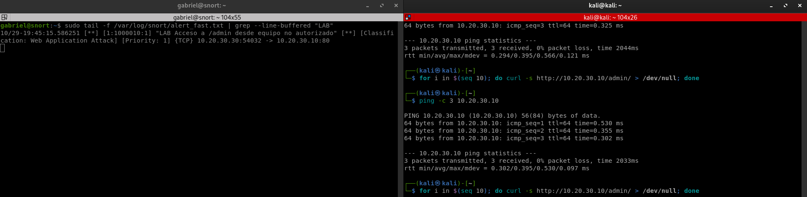

*Con los filtros activos, pese a lanzarse 3 pings y 10 accesos a `/admin`, en el registro aparece una única alerta de `/admin` y ninguna de ping.*

| Regla            | Sin filtros                         | Con filtros  | Mecanismo      |
| ---------------- | ----------------------------------- | ------------ | -------------- |
| ping (1000001)   | 3 por cada `ping -c 3`              | 0            | `suppress`     |
| /admin (1000010) | 10 por bucle de curl; 354 con Nikto | 1 por minuto | `event_filter` |

Así, el administrador reduce el ruido sin perder la capacidad de detección: las reglas siguen cargadas y el registro queda legible.

## 10. Acciones de las reglas

La **acción** es la primera palabra de la regla y decide qué hace Snort cuando un paquete coincide. Hay ocho acciones, agrupadas en dos familias: las que solo observan y las que modifican el tráfico.

### 10.1 Las ocho acciones

| Acción    | Qué hace                                                                   | Caso de uso                                                                                                                                     |
| --------- | -------------------------------------------------------------------------- | ----------------------------------------------------------------------------------------------------------------------------------------------- |
| `alert`   | Genera una alerta y registra el paquete                                    | Detectar un ataque y avisar. Es la acción de todas las reglas de los apartados 8 y 9                                                            |
| `log`     | Registra el paquete sin generar alerta                                     | Guardar tráfico de interés para analizarlo después, sin llenar el registro de alertas (por ejemplo, todo el tráfico hacia un servidor sensible) |
| `pass`    | Ignora el paquete y no lo evalúa con más reglas                            | Lista blanca: eximir a un equipo o tráfico legítimo de una regla que, si no, daría falsos positivos                                             |
| `drop`    | Descarta el paquete y genera una alerta                                    | Bloquear un paquete malicioso concreto                                                                                                          |
| `block`   | Descarta el paquete y bloquea el resto de la sesión                        | Cortar toda una conexión de ataque, no solo un paquete                                                                                          |
| `reject`  | Descarta y envía un TCP RST o un ICMP *unreachable* a los extremos         | Cortar la conexión de forma activa para que el atacante sepa que se ha cerrado                                                                  |
| `react`   | Envía una respuesta (por ejemplo una página de aviso) y cierra la conexión | Mostrar un mensaje al usuario que intenta acceder a un recurso prohibido                                                                        |
| `rewrite` | Modifica el contenido del paquete antes de reenviarlo                      | Normalizar o neutralizar parte del tráfico (por ejemplo, borrar una cabecera peligrosa)                                                         |

Las tres primeras (`alert`, `log`, `pass`) son **pasivas**: no tocan el tráfico, solo deciden qué se registra. Funcionan en nuestro montaje con puerto espejo. Las cinco restantes (`drop`, `block`, `reject`, `react`, `rewrite`) son **activas**: necesitan que Snort esté en modo *inline* (IPS), con el tráfico pasando a través de él.

### 10.2 Demostración de `pass`

Se crean dos reglas sobre el acceso a `/config`: una `alert` para cualquier origen y una `pass` que exime a `cliente-linux`, tratado como máquina de administración autorizada.

```text
alert tcp any any -> $SERVIDOR_LAB 80 ( msg:"LAB Acceso a /config"; flow:to_server,established; service:http; http_uri; content:"/config",nocase; sid:1000040; rev:1; )
pass  tcp 10.20.30.21 any -> $SERVIDOR_LAB 80 ( flow:to_server,established; service:http; http_uri; content:"/config",nocase; sid:1000041; rev:1; )
```

Se accede a `/config` desde las dos máquinas y se observa el registro en directo:

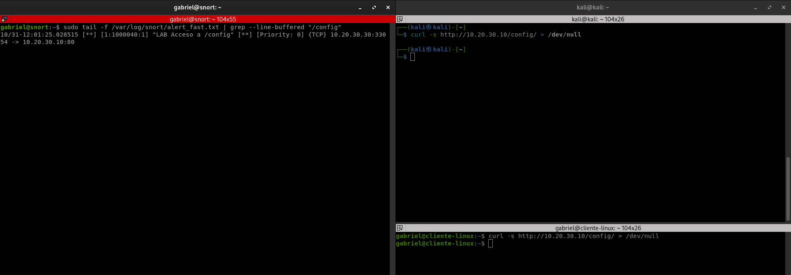

*Pese a que ambas máquinas acceden a `/config`, solo se genera alerta por el acceso del atacante (10.20.30.30). El acceso de `cliente-linux` (10.20.30.21) queda exento por la regla `pass`.*

En Snort 3, las reglas `pass` tienen prioridad por defecto: cuando un paquete coincide a la vez con una regla `pass` y una `alert`, se aplica la `pass` y no se genera la alerta. Es el mecanismo para construir excepciones (listas blancas) sobre reglas más generales.

### 10.3 Acciones de bloqueo en este laboratorio

Las acciones activas no se aplican en el laboratorio porque el sensor está conectado a un puerto espejo: recibe una **copia** del tráfico, así que descartar esa copia no detiene el paquete original, que ya ha llegado a su destino. Es la contrapartida del diseño SPAN descrita en el apartado 5.

Para que estas acciones tuvieran efecto, Snort tendría que colocarse **en línea** entre el atacante y el servidor (modo IPS), de dos formas:

| Método                   | Cómo                                                                                                                  |
| ------------------------ | --------------------------------------------------------------------------------------------------------------------- |
| Dos interfaces en puente | El tráfico entra por una tarjeta y sale por otra; Snort reenvía solo lo que permite (`daq afpacket` en modo `inline`) |
| NFQUEUE                  | El cortafuegos del equipo (`nftables`) envía cada paquete a Snort, que decide si pasa o se descarta (`daq nfq`)       |

Snort también ofrece un modo intermedio, `inline-test`, en el que registra lo que *habría* bloqueado (anota *would drop*) sin llegar a hacerlo, útil para probar reglas de bloqueo antes de activarlas. En este trabajo el sensor funciona como IDS puro, por lo que estas acciones se describen pero no se aplican.

## 11. Alertas por correo electrónico

Snort no envía correos por sí mismo. La notificación se construye en tres piezas: Snort escribe las alertas en `alert_fast.txt`, un script vigila ese fichero y, cuando aparece una alerta de prioridad alta, envía un correo con **msmtp** a través de Gmail.

```
Snort -> alert_fast.txt -> script vigilante -> msmtp -> Gmail -> correo del administrador
```

### 11.1 Configuración de msmtp

`msmtp` es un cliente SMTP ligero que solo envía correo. Se instala en el sensor y se configura para usar el servidor de Gmail:

```bash
sudo apt install -y msmtp msmtp-mta mailutils
```

Gmail no admite la contraseña normal de la cuenta para programas externos, por lo que se crea una **contraseña de aplicación** de 16 caracteres (requiere tener activada la verificación en dos pasos). La configuración va en `/etc/msmtprc`:

```text
defaults
auth           on
tls            on
tls_trust_file /etc/ssl/certs/ca-certificates.crt
logfile        /var/log/msmtp.log

account        gmail
host           smtp.gmail.com
port           587
from           gabrielbusiness2007@gmail.com
user           gabrielbusiness2007@gmail.com
password       ********************

account default : gmail
```

El fichero contiene la contraseña, por lo que se protege con `sudo chmod 600 /etc/msmtprc`. Se comprueba el envío con un correo de prueba:

```bash
printf "Subject: Prueba Snort\n\nCorreo de prueba." | sudo msmtp -a gmail gabrielbusiness2007@gmail.com
```

### 11.2 Script de vigilancia

Un script en Bash vigila el fichero de alertas con `tail -F` y, por cada línea de prioridad alta (`Priority: 1`, que corresponde a los ataques más graves), envía un correo. Para no saturar el buzón ante un ataque que genera miles de alertas (como un escaneo de Nikto), aplica un **tiempo de espera** (`COOLDOWN`) de 120 segundos entre correos: durante ese intervalo cuenta las alertas y las resume en el siguiente aviso.

```bash
LOG_ALERTAS="/var/log/snort/alert_fast.txt"
DESTINO="gabrielbusiness2007@gmail.com"
PATRON_PRIORIDAD="Priority: 1"
COOLDOWN=120

procesar_linea() {
    local linea="$1"
    local es_prioritaria=0
    if printf "%s" "$linea" | grep -q "$PATRON_PRIORIDAD"; then
        es_prioritaria=1
    fi
    if [ "$es_prioritaria" -eq 1 ]; then
        contador=$((contador + 1))
        ahora="$(date +%s)"
        if [ $((ahora - ultimo_envio)) -ge "$COOLDOWN" ]; then
            enviar_correo "$linea" "$contador"
            ultimo_envio="$ahora"
            contador=0
        fi
    fi
}
```

*(El script completo está en el anexo.)* Se ejecuta como servicio systemd, que arranca junto a Snort y se reinicia solo si falla:

```ini
[Unit]
Description=Envio de alertas de Snort por correo electronico
After=snort3.service
Requires=snort3.service

[Service]
Type=simple
ExecStart=/usr/local/bin/alerta-correo.sh
Restart=on-failure
RestartSec=10

[Install]
WantedBy=multi-user.target
```

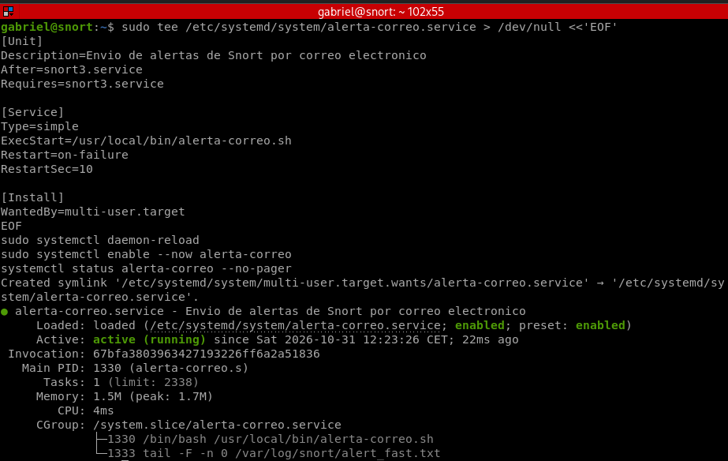

### 11.3 Prueba del flujo completo

Con el servicio activo, se genera una alerta de prioridad alta desde la máquina atacante:

```bash
curl -s http://10.20.30.10/admin/ > /dev/null
```

En unos segundos llega el correo con los detalles de la alerta:

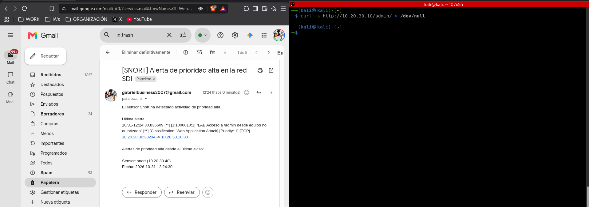

*El correo incluye la alerta que lo ha disparado (`LAB Acceso a /admin`, prioridad 1, desde 10.20.30.30), el número de alertas de prioridad alta agrupadas, el sensor de origen y la fecha.*

Así, el administrador recibe un aviso inmediato de los ataques graves sin tener que vigilar el registro de forma continua.

## 12. Demostración del funcionamiento

Este apartado integra todo lo anterior en una secuencia de intrusión completa. Un atacante real no lanza un ataque aislado, sino una cadena de fases: primero reconoce la red, después busca puntos débiles y por último ataca los servicios. El SDI detecta cada fase, y las más graves disparan un correo automático.

### 12.1 La cadena de ataque

Todas las acciones se lanzan desde la máquina atacante (`10.20.30.30`) contra el servidor (`10.20.30.10`):

| Fase                         | Acción del atacante               | Herramienta    | Qué detecta Snort                                                    | Aviso por correo    |
| ---------------------------- | --------------------------------- | -------------- | -------------------------------------------------------------------- | ------------------- |
| 1. Descubrimiento            | Escaneo de los 65535 puertos      | `nmap -sS -p-` | `port_scan` (122), regla interna                                     | No (prioridad baja) |
| 2. Enumeración               | Identificar programas y versiones | `nmap -sV -sC` | `http_inspect`, `ssh`, `dce_smb` y reglas de la comunidad            | No                  |
| 3. Reconocimiento web        | Buscar vulnerabilidades web       | `nikto`        | Reglas de la comunidad (RFI, Shellshock…) y la regla propia `/admin` | Sí                  |
| 4. Acceso no autorizado      | Entrar al panel de administración | `curl /admin`  | Regla propia 1000010 (web-application-attack)                        | Sí                  |
| 5. Ataque de credenciales    | Fuerza bruta contra SSH           | `hydra`        | Regla propia 1000030 (attempted-user)                                | Sí                  |
| 6. Ataque a la base de datos | Acceso y borrado de tablas        | `psql`         | Reglas propias 1000021 y 1000020                                     | Sí                  |

Las fases de reconocimiento (1 y 2) generan alertas de prioridad baja: quedan registradas, pero no saturan el correo del administrador. Las fases de ataque real (3 a 6) son de prioridad alta y disparan la notificación. Las capturas de cada detección están en los apartados 7 (reglas por defecto) y 8 (reglas propias).

### 12.2 Notificación de los ataques graves

El administrador recibe un correo por cada tipo de ataque grave, sin tener que vigilar el registro. Los tres ejemplos siguientes corresponden a las fases 4, 5 y 6 de la cadena.

**Fase 4 — Acceso al panel de administración:**


**Fase 5 — Fuerza bruta contra SSH:**

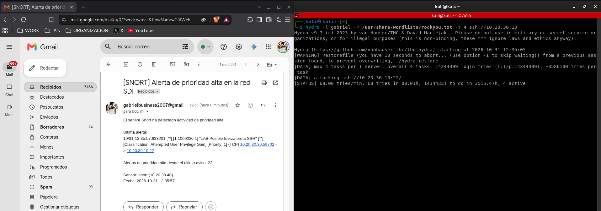

*El correo resume 22 alertas de prioridad alta en un único aviso, gracias al agrupamiento del script: un ataque de fuerza bruta genera muchas alertas, pero el administrador recibe un solo correo.*

**Fase 6 — Intento de acceso a la base de datos:**

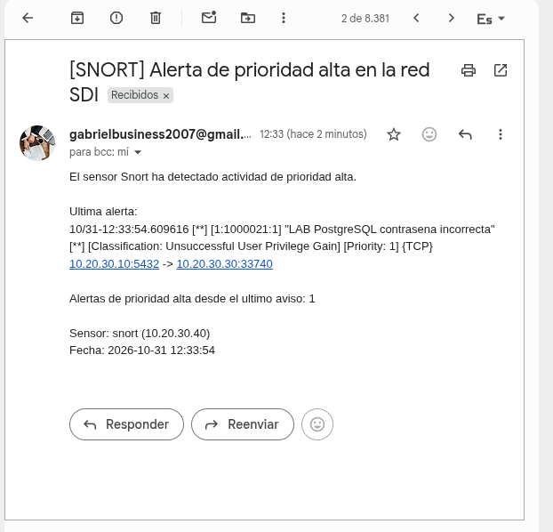

### 12.3 Conclusión

La demostración confirma que el sistema cumple su función en los tres niveles:

- **Detección**: Snort identifica cada fase del ataque, desde el reconocimiento silencioso hasta la explotación de los servicios, combinando las reglas internas, las de la comunidad y las propias del escenario.
- **Registro**: todas las alertas quedan en `alert_fast.txt` y `alert_json.txt` para su análisis posterior.
- **Notificación**: los ataques de prioridad alta generan un aviso inmediato por correo, con control de frecuencia para no saturar.

El sensor, situado en un puerto espejo, realiza todo esto de forma pasiva: observa la red sin interferir en ella, de modo que si Snort falla, el tráfico legítimo sigue circulando con normalidad.

## Anexo. Scripts del laboratorio

El laboratorio se gestiona con cuatro scripts en Bash, guardados en la carpeta del proyecto. Automatizan tareas que, si no, habría que repetir a mano en cada sesión.

| Script             | Función                                                                                                       | Apartado |
| ------------------ | ------------------------------------------------------------------------------------------------------------- | -------- |
| `lab-up.sh`        | Arranca el laboratorio: crea el switch, da al host la IP y el NAT, enciende las VM y activa el port mirroring | 4.5      |
| `lab-down.sh`      | Apaga las VM de forma ordenada y, opcionalmente, crea una instantánea de cada una                             | 4        |
| `crear-vms.sh`     | Crea las tres máquinas Debian desde la imagen cloud mediante cloud-init                                       | 4.6      |
| `alerta-correo.sh` | Vigila las alertas y envía un correo cuando detecta actividad de prioridad alta                               | 11       |

Como la configuración de red del host (IP, NAT y mirror) no se conserva al reiniciar, `lab-up.sh` se ejecuta al principio de cada sesión de trabajo. A continuación se incluye su código completo; el resto de scripts se encuentran en la carpeta del proyecto.

[Todos los scripts del lab](./scripts-lab.zip)

```bash
#!/bin/bash
# lab-up.sh - Arranca el laboratorio SDI: switch Open vSwitch, NAT del host, VMs y port mirroring de toda la red hacia el sensor Snort

BRIDGE="br-lab"
RED_LAB="10.20.30.0/24"
IP_HOST="10.20.30.1/24"
PUERTO_SENSOR="lab-snort-mon"
VMS="snort servidor cliente-linux cliente-windows atacante"

comprobar_root() {
    if [ "$(id -u)" -ne 0 ]; then
        printf "Ejecuta el script con sudo\n"
        exit 1
    fi
}

configurar_red_host() {
    if ! ovs-vsctl br-exists "$BRIDGE"; then
        ovs-vsctl add-br "$BRIDGE"
        printf "Bridge %s creado\n" "$BRIDGE"
    fi
    if ! ip addr show dev "$BRIDGE" | grep -q "${IP_HOST%/*}/"; then
        ip addr add "$IP_HOST" dev "$BRIDGE"
    fi
    ip link set "$BRIDGE" up
    sysctl -qw net.ipv4.ip_forward=1
    if ! nft list table ip lab >/dev/null 2>&1; then
        nft add table ip lab
        nft add chain ip lab post '{ type nat hook postrouting priority 100 ; }'
        nft add rule ip lab post ip saddr "$RED_LAB" oifname != "$BRIDGE" masquerade
    fi
    printf "Red del host lista: %s con salida NAT a internet\n" "$IP_HOST"
}

arrancar_vms() {
    for vm in $VMS; do
        if virsh list --name --state-running | grep -qx "$vm"; then
            printf "%s ya estaba encendida\n" "$vm"
        elif virsh dominfo "$vm" >/dev/null 2>&1; then
            virsh start "$vm" >/dev/null
            printf "%s arrancada\n" "$vm"
        else
            printf "%s no existe, se omite\n" "$vm"
        fi
    done
}

esperar_puerto() {
    local puerto="$1"
    local intentos=0
    while ! ovs-vsctl list-ports "$BRIDGE" | grep -qx "$puerto" && [ "$intentos" -lt 30 ]; do
        sleep 1
        intentos=$((intentos + 1))
    done
    ovs-vsctl list-ports "$BRIDGE" | grep -qx "$puerto"
}

configurar_mirror() {
    if ! virsh list --name --state-running | grep -qx "snort"; then
        printf "La VM snort no esta encendida: se omite el port mirroring\n"
    elif esperar_puerto "$PUERTO_SENSOR"; then
        ovs-vsctl clear Bridge "$BRIDGE" mirrors
        ovs-vsctl -- --id=@mon get Port "$PUERTO_SENSOR" \
                  -- --id=@m create Mirror name=span-sdi select-all=true output-port=@mon \
                  -- set Bridge "$BRIDGE" mirrors=@m >/dev/null
        printf "Port mirroring activo: toda la red %s -> %s\n" "$BRIDGE" "$PUERTO_SENSOR"
    else
        printf "No se encontro el puerto %s en %s\n" "$PUERTO_SENSOR" "$BRIDGE"
        exit 1
    fi
}

main() {
    comprobar_root
    configurar_red_host
    arrancar_vms
    configurar_mirror
    printf "Laboratorio listo\n"
}

main
```